# Jarkom-Modul-3-2026-K-50

## Member

| No  | Nama                   | NRP        | Pengerjaan Soal |
| --- | ---------------------- | ---------- | --------------- |
| 1   | Marvelino Davas        | 5027251085 | 1-10            |
| 2   | Nathania Tiara Wahyudi | 5027251089 | 11-20           |

---

## Ringkasan Topologi

Prefix IP kelompok: `192.236`. Semua subnet memakai `/24`. `<xxxx>` diisi `K50`, sehingga domain-search menjadi `K50.com`.

| Jaringan  | Network          | Gateway (jichi)         | Isi                                          |
| --------- | ---------------- | ----------------------- | -------------------------------------------- |
| WAN       | 192.168.122.0/24 | `eth0` (DHCP dari NAT1) | Akses internet                               |
| Network 1 | 192.236.1.0/24   | `eth1` 192.236.1.1      | DMZ: utahime, shoko, gojo                    |
| Network 2 | 192.236.2.0/24   | `eth2` 192.236.2.1      | Divisi A: itadori, fushiguro, zenin, okkotsu |
| Network 3 | 192.236.3.0/24   | `eth3` 192.236.3.1      | Divisi B: ino, kusakabe, miwa, kugisaki      |
| Network 4 | 192.236.4.0/24   | `eth4` 192.236.4.1      | Data Center: tengen, geto, worker, database  |

Catatan umum pengerjaan:

- Semua script disimpan di `/root` node terkait dan salinannya ada di folder [script/](script/).
- Image `debinet` tidak memakai systemd. File `/root/init.sh` dijalankan otomatis setiap node boot, sehingga autostart layanan dipasang di sana.
- Alamat client dari pool dinamis bisa berbeda antar screenshot (misalnya itadori `.2.10` atau `.2.11`). Urutan client meminta lease setelah node di-restart menentukan siapa yang mendapat alamat pertama di pool. Yang dijamin oleh konfigurasi adalah **pool**-nya, bukan angka alamat tertentu, kecuali kugisaki yang selalu `.3.99`.

---

### Soal 1: Konektivitas Dasar, IPv4 Forwarding, dan Source NAT
> Ketika Curtain menutup Shibuya, jalur komunikasi antar zona Jujutsu High terputus. Pulihkan konektivitas dasar dengan mengonfigurasi jichi: eth0 memperoleh WAN dari NAT, sedangkan eth1–eth4 menjadi gateway Network 1–4 sesuai tabel pemetaan. Aktifkan IPv4 forwarding dan source NAT, lalu tetapkan IP statis host infrastruktur sesuai tabel spesifikasi. Buktikan konektivitas setiap host ke gateway dan akses eksternal dari host yang relevan.

#### Tabel IP host infrastruktur

| Node    | IP           | Gateway     | Peran                  |
| ------- | ------------ | ----------- | ---------------------- |
| utahime | 192.236.1.2  | 192.236.1.1 | DNS Master             |
| shoko   | 192.236.1.3  | 192.236.1.1 | DNS Slave              |
| gojo    | 192.236.1.4  | 192.236.1.1 | Public Reverse Proxy   |
| geto    | 192.236.4.2  | 192.236.4.1 | Internal Load Balancer |
| maki    | 192.236.4.3  | 192.236.4.1 | Worker frontend        |
| panda   | 192.236.4.4  | 192.236.4.1 | Worker frontend        |
| nanami  | 192.236.4.5  | 192.236.4.1 | Worker API utama       |
| todo    | 192.236.4.6  | 192.236.4.1 | Worker API utama       |
| kirara  | 192.236.4.7  | 192.236.4.1 | Worker API cadangan    |
| tengen  | 192.236.4.10 | 192.236.4.1 | DHCP Server            |
| yaga    | 192.236.4.20 | 192.236.4.1 | Database Master        |
| inumaki | 192.236.4.21 | 192.236.4.1 | Database Slave         |

#### Konfigurasi jichi (`/etc/network/interfaces`)

```
auto lo
iface lo inet loopback

# WAN -> NAT1
auto eth0
iface eth0 inet dhcp

# Network 1 (DMZ)
auto eth1
iface eth1 inet static
    address 192.236.1.1
    netmask 255.255.255.0

# Network 2 (Divisi A)
auto eth2
iface eth2 inet static
    address 192.236.2.1
    netmask 255.255.255.0

# Network 3 (Divisi B)
auto eth3
iface eth3 inet static
    address 192.236.3.1
    netmask 255.255.255.0

# Network 4 (Data Center)
auto eth4
iface eth4 inet static
    address 192.236.4.1
    netmask 255.255.255.0
```

eth0 mengambil alamat dari NAT1 lewat DHCP, sedangkan eth1 sampai eth4 diberi alamat `.1` di tiap network sehingga menjadi gateway bagi host di network tersebut.

#### Aktifkan IPv4 forwarding dan source NAT di jichi (`/root/soal01-jichi.sh`)

```bash
#!/bin/bash
PREFIX="192.236"

# IPv4 forwarding
sysctl -w net.ipv4.ip_forward=1
grep -q '^net.ipv4.ip_forward=1' /etc/sysctl.conf 2>/dev/null || echo 'net.ipv4.ip_forward=1' >> /etc/sysctl.conf

# Source NAT: Network 1-4 keluar lewat eth0 (NAT1)
iptables -t nat -C POSTROUTING -s $PREFIX.0.0/16 -o eth0 -j MASQUERADE 2>/dev/null ||
    iptables -t nat -A POSTROUTING -s $PREFIX.0.0/16 -o eth0 -j MASQUERADE

# Resolver untuk persiapan awal
echo "nameserver 192.168.122.1" > /etc/resolv.conf
```

- `ip_forward=1` membuat jichi meneruskan paket antar network, bukan membuangnya.
- MASQUERADE hanya untuk trafik yang keluar lewat `eth0` (internet). NAT1 tidak mengenal alamat `192.236.x.x`, jadi alamat sumbernya diganti menjadi IP eth0 jichi. Trafik antar network internal tidak di-NAT, sehingga alamat asli host tetap terlihat.
- Aturan NAT dicek dulu dengan `-C` supaya tidak dobel ketika script dijalankan ulang.

#### Konfigurasi host infrastruktur (`/etc/network/interfaces`)

Contoh untuk tengen. Host lain memakai pola yang sama dengan IP dan gateway sesuai tabel; file lengkap tiap node ada di [script/soal01/interfaces/](script/soal01/interfaces/).

```
auto lo
iface lo inet loopback

auto eth0
iface eth0 inet static
    address 192.236.4.10
    netmask 255.255.255.0
    gateway 192.236.4.1
    up echo nameserver 192.168.122.1 > /etc/resolv.conf
```

#### Verifikasi di jichi

```bash
ip -br a
ip route
sysctl net.ipv4.ip_forward
iptables -t nat -S POSTROUTING
ping -c 2 8.8.8.8
ping -c 2 google.com
```

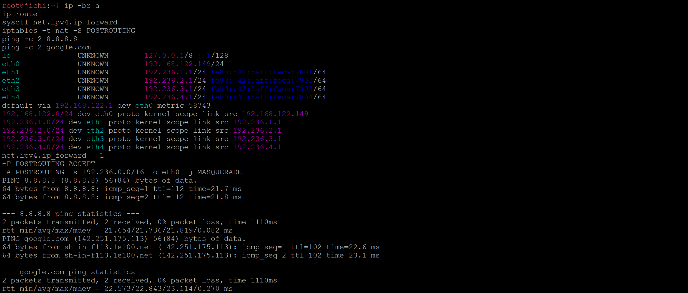

eth1 sampai eth4 sudah menjadi gateway `.1` di tiap network, `ip_forward = 1`, ada satu aturan MASQUERADE `-o eth0`, dan jichi bisa mengakses internet.

#### Verifikasi di host infrastruktur

```bash
ip -br a show eth0
ip route
ping -c 2 192.236.X.1     # gateway
ping -c 2 8.8.8.8         # akses eksternal lewat source NAT jichi
ping -c 1 google.com
```

Diambil tiga host sebagai perwakilan: utahime (Network 1), tengen dan yaga (Network 4). utahime dan yaga juga melakukan ping lintas network untuk membuktikan routing dua arah lewat jichi.

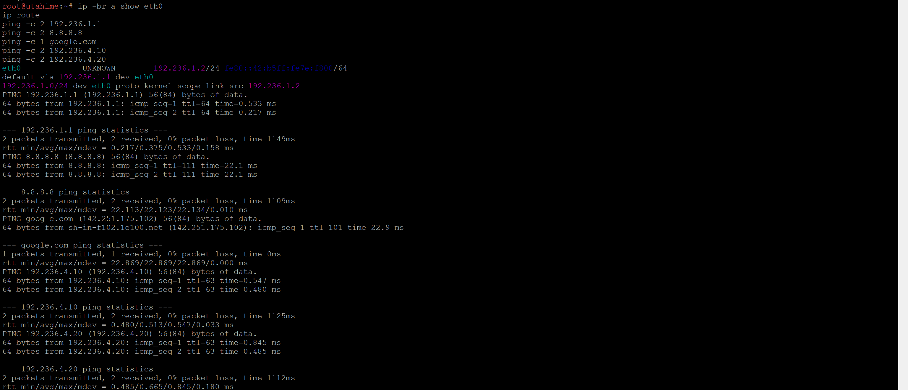

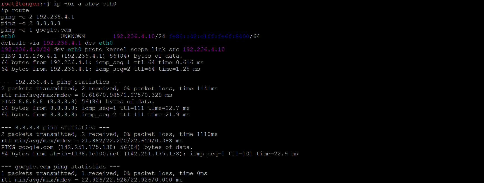

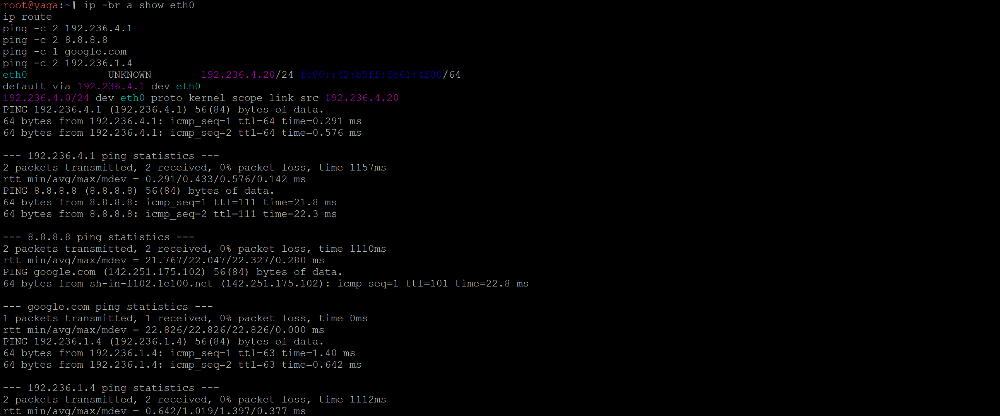

Ping ke gateway memiliki `ttl=64`, sedangkan ping lintas network (utahime ke `192.236.4.10` dan `192.236.4.20`, yaga ke `192.236.1.4`) memiliki `ttl=63`. Selisih satu menunjukkan paket melewati satu router, yaitu jichi.

----

### Soal 2: DHCP Server pada tengen
> Tengen, penjaga pusat distribusi di Data Center, harus mengambil alih pengalokasian alamat bagi wilayah yang membutuhkan konfigurasi dinamis. Konfigurasikan isc-dhcp-server pada [PREFIX IP].4.10. Deklarasikan Network 4 ([PREFIX IP].4.0/24) sebagai subnet lokal tanpa pool dinamis, lalu siapkan scope DHCP untuk Network 2 ([PREFIX IP].2.0/24) dan Network 3 ([PREFIX IP].3.0/24). Validasi konfigurasi dan pastikan service aktif tanpa error "No subnet declaration".

#### Install dan konfigurasi di tengen (`/root/soal02-tengen.sh`)

```bash
#!/bin/bash
PREFIX="192.236"

if ! command -v dhcpd >/dev/null 2>&1; then
    apt-get update
    DEBIAN_FRONTEND=noninteractive apt-get install -y isc-dhcp-server
fi

# dhcpd hanya listen di eth0 (Network 4)
sed -i 's/^INTERFACESv4=.*/INTERFACESv4="eth0"/' /etc/default/isc-dhcp-server

cat > /etc/dhcp/dhcpd.conf <<EOF
authoritative;
ddns-update-style none;

default-lease-time 600;
max-lease-time 7200;

# Network 4 (Data Center) - subnet lokal tengen, tanpa pool dinamis
subnet $PREFIX.4.0 netmask 255.255.255.0 {
}

# Network 2 (Divisi A)
subnet $PREFIX.2.0 netmask 255.255.255.0 {
    range $PREFIX.2.10 $PREFIX.2.35;
    range $PREFIX.2.70 $PREFIX.2.95;
    option routers $PREFIX.2.1;
    option subnet-mask 255.255.255.0;
    option broadcast-address $PREFIX.2.255;
}

# Network 3 (Divisi B)
subnet $PREFIX.3.0 netmask 255.255.255.0 {
    range $PREFIX.3.10 $PREFIX.3.89;
    range $PREFIX.3.100 $PREFIX.3.199;
    option routers $PREFIX.3.1;
    option subnet-mask 255.255.255.0;
    option broadcast-address $PREFIX.3.255;
}
EOF

# Validasi dulu, baru restart
dhcpd -t -cf /etc/dhcp/dhcpd.conf || exit 1
pgrep -x dhcpd >/dev/null || rm -f /var/run/dhcpd.pid
service isc-dhcp-server restart
service isc-dhcp-server status
```

Subnet Network 4 dideklarasikan kosong. Tanpa deklarasi ini `dhcpd` menolak berjalan di `eth0` dengan pesan "No subnet declaration for eth0", karena interface tempat ia listen tidak punya subnet yang dikenali. Scope Network 2 dan Network 3 tetap dideklarasikan walaupun tengen tidak berada di sana, karena request dari kedua network itu akan datang lewat relay (soal 3).

#### Verifikasi di tengen

```bash
dhcpd -t -cf /etc/dhcp/dhcpd.conf
service isc-dhcp-server status
grep INTERFACESv4 /etc/default/isc-dhcp-server
ps aux | grep dhcpd
ss -ulnp | grep :67
```

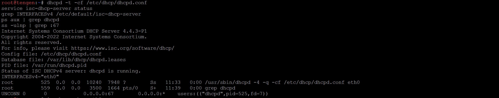

`dhcpd -t` lolos tanpa error "No subnet declaration", service berjalan, dan `dhcpd` listen di UDP 67 pada `eth0`.

----

### Soal 3: DHCP Relay pada jichi
> Permintaan alamat dari Divisi A dan Divisi B tidak dapat menyeberangi subnet secara langsung. Konfigurasikan jichi sebagai DHCP Relay menuju tengen ([PREFIX IP].4.10), menggunakan eth2 untuk Network 2 dan eth3 untuk Network 3. Buktikan bahwa client dari kedua subnet berhasil memperoleh lease melalui relay.

#### Install dan konfigurasi relay di jichi (`/root/soal03-jichi.sh`)

```bash
#!/bin/bash
PREFIX="192.236"

if ! command -v dhcrelay >/dev/null 2>&1; then
    apt-get update
    DEBIAN_FRONTEND=noninteractive apt-get install -y isc-dhcp-relay
fi

# eth2/eth3 = sisi client (downstream), eth4 = sisi tengen (upstream).
# Tanpa eth4, balasan dari tengen dibuang oleh relay.
cat > /etc/default/isc-dhcp-relay <<EOF
SERVERS="$PREFIX.4.10"
INTERFACES=""
OPTIONS="-id eth2 -id eth3 -iu eth4"
EOF

pgrep -x dhcrelay >/dev/null || rm -f /var/run/dhcrelay.pid
service isc-dhcp-relay restart
service isc-dhcp-relay status
```

`eth2` dan `eth3` dipasang sebagai interface downstream (menerima request client), sedangkan `eth4` sebagai upstream ke tengen. Percobaan pertama hanya dengan `INTERFACES="eth2 eth3"` gagal: capture di tengen menunjukkan request sudah diteruskan dan tengen sudah membalas ke `192.236.2.1`, tetapi relay membuang balasan itu karena datang dari interface yang tidak ia dengarkan, sehingga tidak ada client yang mendapat lease.

```bash
cat /etc/default/isc-dhcp-relay
ps -e -o pid,args | grep dhcrelay
```

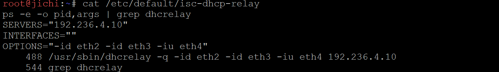

#### Konfigurasi delapan client (`/etc/network/interfaces`)

```
auto lo
iface lo inet loopback

# -O search: minta DHCP option 119 (domain-search) ke server
auto eth0
iface eth0 inet dhcp
    udhcpc_opts -O search
```

#### Minta lease di client

```bash
ip link show eth0
ifdown eth0; ifup eth0
ip a
ip route
```

Client Network 2 (itadori):

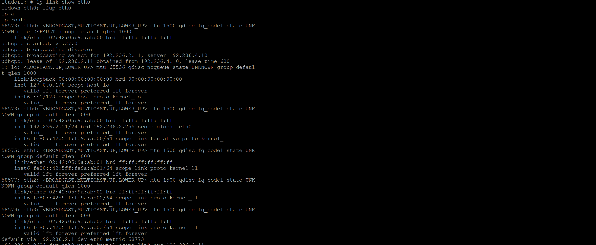

Client Network 3 (ino):

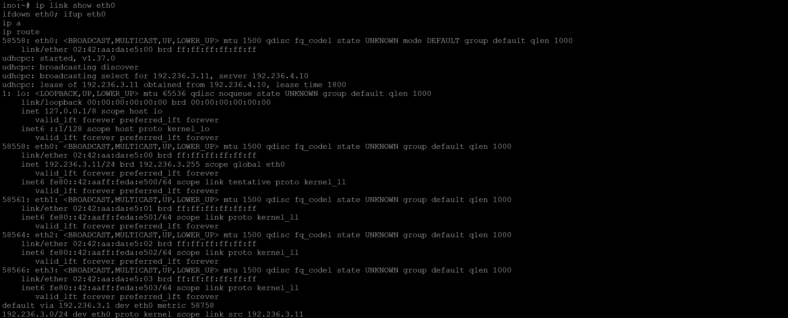

itadori mendapat `192.236.2.11` dengan gateway `192.236.2.1`, dan ino mendapat `192.236.3.11` dengan gateway `192.236.3.1`. Keduanya diberikan oleh `192.236.4.10`, padahal tengen berada di Network 4. Ini hanya mungkin karena request diteruskan oleh relay di jichi.

----

### Soal 4: Dua Pool DHCP pada Network 2 dengan DHCP Class
> Agar tim Dev dan Support di Divisi A menerima jatah alamat yang berbeda, atur dua pool DHCP pada Network 2. Tetapkan Pool 1 ([PREFIX IP].2.10–[PREFIX IP].2.35) untuk itadori dan fushiguro, serta Pool 2 ([PREFIX IP].2.70–[PREFIX IP].2.95) untuk zenin dan okkotsu. Rentang [PREFIX IP].2.36–[PREFIX IP].2.69 tidak boleh dialokasikan. Karena seluruh client berada pada subnet yang sama, gunakan DHCP class berdasarkan MAC Address atau Client ID untuk memisahkan kedua kelompok.

#### Ambil MAC Address tiap client

```bash
ip link show eth0
```

| Client    | MAC Address       | Kelas        |
| --------- | ----------------- | ------------ |
| itadori   | 02:42:05:9a:ab:00 | `divA-pool1` |
| fushiguro | 02:42:c3:6e:65:00 | `divA-pool1` |
| zenin     | 02:42:f6:49:44:00 | `divA-pool2` |
| okkotsu   | 02:42:ef:c5:90:00 | `divA-pool2` |

MAC address ini tetap sama walaupun node di-restart atau container dibuat ulang, sehingga aman dipakai sebagai dasar kelas.

#### Perubahan `dhcpd.conf` di tengen (`/root/soal04-tengen.sh`)

```
# Divisi A dipisah per MAC Address (1: = tipe hardware ethernet)
class "divA-pool1" { match hardware; }
subclass "divA-pool1" 1:02:42:05:9a:ab:00;   # itadori
subclass "divA-pool1" 1:02:42:c3:6e:65:00;   # fushiguro

class "divA-pool2" { match hardware; }
subclass "divA-pool2" 1:02:42:f6:49:44:00;   # zenin
subclass "divA-pool2" 1:02:42:ef:c5:90:00;   # okkotsu

# Network 2 (Divisi A) - .2.36 s/d .2.69 tidak dialokasikan
subnet 192.236.2.0 netmask 255.255.255.0 {
    option routers 192.236.2.1;
    option subnet-mask 255.255.255.0;
    option broadcast-address 192.236.2.255;

    pool {
        allow members of "divA-pool1";
        range 192.236.2.10 192.236.2.35;
    }
    pool {
        allow members of "divA-pool2";
        range 192.236.2.70 192.236.2.95;
    }
}
```

- `class ... { match hardware; }` membuat kelas yang anggotanya ditentukan dari hardware address client.
- `subclass ... 1:<MAC>` mendaftarkan MAC ke kelas. `1:` adalah kode tipe hardware Ethernet; nilai dari `match hardware` selalu diawali tipe hardware, jadi tanpa `1:` MAC tidak akan pernah cocok.
- `allow members of` membuat tiap pool hanya melayani anggota kelasnya.
- Rentang `.2.36` sampai `.2.69` tidak masuk `range` mana pun, sehingga tidak pernah dialokasikan.

```bash
grep -n "divA\|range 192.236.2" /etc/dhcp/dhcpd.conf
```

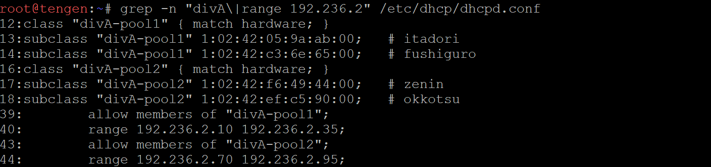

#### Terapkan di tengen, lalu renew di client Network 2

```bash
bash /root/soal04-tengen.sh     # tengen
```

```bash
ip link show eth0               # client Network 2
ifdown eth0; ifup eth0
ip -4 -o addr show eth0
```

Perwakilan Pool 1 (itadori):

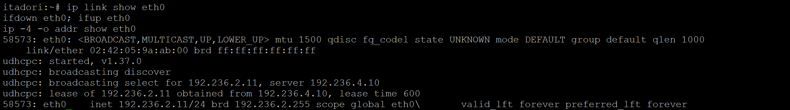

Perwakilan Pool 2 (zenin):

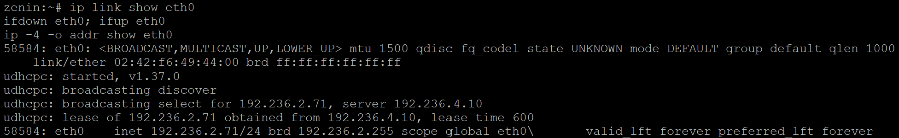

itadori mendapat `192.236.2.11` (Pool 1) dan zenin mendapat `192.236.2.71` (Pool 2). fushiguro dan okkotsu dibuktikan bersama seluruh client di soal 7.

----

### Soal 5: Short Lease, Long Lease, dan DHCP Options pada Network 3
> Setiap tim lapangan memiliki durasi operasi yang berbeda. Pada Network 3, berikan short lease 30 menit (1800 detik) kepada ino dan kusakabe, serta long lease 12 jam (43200 detik) kepada miwa. Gunakan pool short lease [PREFIX IP].3.10–[PREFIX IP].3.89 dan pool long lease [PREFIX IP].3.100–[PREFIX IP].3.199. Sesuaikan default-lease-time dan max-lease-time untuk setiap kelas client. Berikan pula DHCP options berupa DNS [PREFIX IP].1.2 dan [PREFIX IP].1.3, serta domain-search <xxxx>.com.

#### Perubahan `dhcpd.conf` di tengen (`/root/soal05-tengen.sh`)

```
# DHCP options untuk semua client
option domain-name-servers 192.236.1.2, 192.236.1.3;
option domain-search "K50.com";

# Divisi B dipisah per MAC Address
class "divB-short" { match hardware; }
subclass "divB-short" 1:02:42:aa:da:e5:00;   # ino
subclass "divB-short" 1:02:42:5a:e2:39:00;   # kusakabe

class "divB-long" { match hardware; }
subclass "divB-long" 1:02:42:35:f5:07:00;    # miwa

# Network 3 (Divisi B)
subnet 192.236.3.0 netmask 255.255.255.0 {
    option routers 192.236.3.1;
    option subnet-mask 255.255.255.0;
    option broadcast-address 192.236.3.255;

    # short lease 30 menit
    pool {
        allow members of "divB-short";
        range 192.236.3.10 192.236.3.89;
        default-lease-time 1800;
        max-lease-time 1800;
    }
    # long lease 12 jam
    pool {
        allow members of "divB-long";
        range 192.236.3.100 192.236.3.199;
        default-lease-time 43200;
        max-lease-time 43200;
    }
}
```

- Lease time dipasang di dalam masing-masing pool, sehingga tiap kelas client mendapat durasi sendiri. `default-lease-time` dan `max-lease-time` dibuat sama supaya client tidak bisa meminta lease lebih panjang dari kelasnya.
- DNS dan domain-search ditaruh di tingkat global supaya berlaku untuk Network 2 dan Network 3 sekaligus.
- `default-lease-time 600` dan `max-lease-time 7200` di bagian atas file adalah nilai global untuk client yang tidak masuk pool berlease khusus, yaitu Network 2 dan kugisaki.

```bash
grep -n "domain-\|divB\|range 192.236.3\|lease-time" /etc/dhcp/dhcpd.conf
```

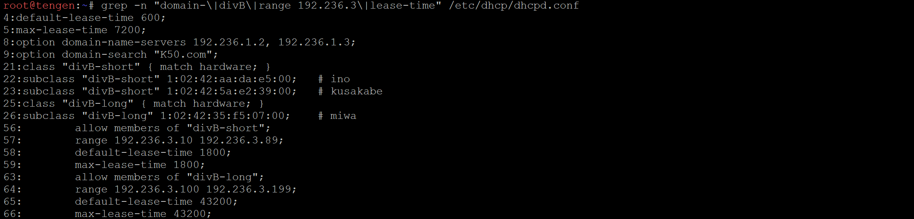

#### Terapkan di tengen, lalu renew di client Network 3

```bash
bash /root/soal05-tengen.sh     # tengen
```

```bash
ifdown eth0; ifup eth0          # client Network 3
ip -4 -o addr show eth0
cat /etc/resolv.conf
```

Perwakilan short lease (ino):


Perwakilan long lease (miwa):

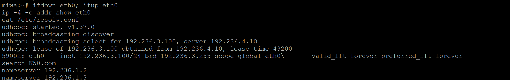

ino mendapat alamat di pool short lease dengan `lease time 1800`, sedangkan miwa mendapat `192.236.3.100` di pool long lease dengan `lease time 43200`. Di kedua client, `resolv.conf` berisi `search K50.com`, `nameserver 192.236.1.2`, dan `nameserver 192.236.1.3`.

Baris `search K50.com` baru muncul setelah `udhcpc_opts -O search` ditambahkan di `/etc/network/interfaces` client. `udhcpc` bawaan alpinet tidak meminta option 119 secara default, jadi tanpa baris itu server tidak mengirimkannya walaupun sudah dikonfigurasi.

Pada tahap ini kugisaki belum mendapat alamat, karena MAC-nya bukan anggota kelas mana pun. Itu diselesaikan di soal 6.

----

### Soal 6: Static Lease untuk kugisaki
> Kugisaki ditetapkan sebagai personel VIP yang harus mempertahankan alamat yang sama setiap kali terhubung. Buat DHCP static lease berdasarkan MAC Address client tersebut dengan fixed address [PREFIX IP].3.99. Pastikan alamat ini berada di luar seluruh pool dinamis, validasi konfigurasi server, lalu renew lease pada client. Buktikan bahwa alamat yang diterima sesuai dengan reservasi.

#### Perubahan `dhcpd.conf` di tengen (`/root/soal06-tengen.sh`)

```
# Static lease kugisaki (di luar pool .3.10-.3.89 dan .3.100-.3.199)
host kugisaki {
    hardware ethernet 02:42:7e:5f:c8:00;
    fixed-address 192.236.3.99;
}
```

`192.236.3.99` terletak di antara pool short lease (berakhir di `.3.89`) dan pool long lease (mulai di `.3.100`), sehingga tidak bisa diberikan ke client lain. Script soal 6 berisi konfigurasi DHCP final; isi lengkapnya ada di [script/soal06/soal06-tengen.sh](script/soal06/soal06-tengen.sh).

#### Validasi di tengen

```bash
bash /root/soal06-tengen.sh     # tengen: dhcpd -t lalu restart
grep -n -A3 "host kugisaki" /etc/dhcp/dhcpd.conf
grep -n "range 192.236.3" /etc/dhcp/dhcpd.conf
dhcpd -t -cf /etc/dhcp/dhcpd.conf
```


#### Renew di kugisaki

```bash
ip link show eth0
ifdown eth0; ifup eth0
ip -4 -o addr show eth0
```

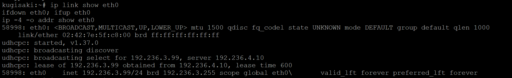

Renew diulang sekali lagi untuk membuktikan alamatnya tetap sama setiap kali terhubung:

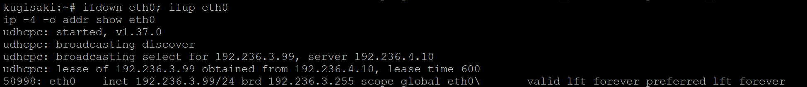

Kedua renew menghasilkan `192.236.3.99` dari `192.236.4.10`. Lease time kugisaki 600 detik karena host dengan fixed address tidak masuk pool mana pun, sehingga memakai `default-lease-time` global; soal tidak menentukan lease time untuk kugisaki.

----

### Soal 7: Verifikasi Konfigurasi Client dan Pencocokan Lease
> Setelah aturan alokasi diterapkan, pastikan setiap client menerima konfigurasi jaringan sesuai wilayahnya: subnet mask 255.255.255.0 (/24), gateway dan broadcast address yang benar, DNS [PREFIX IP].1.2 serta [PREFIX IP].1.3, dan domain-search yang ditentukan. Periksa IP address dan routing seluruh client Divisi A dan Divisi B, kemudian cocokkan lease dengan /var/lib/dhcp/dhcpd.leases pada tengen. Pastikan tidak ada alamat yang bertabrakan atau berada di luar kebijakan pool.

#### Periksa konfigurasi di tiap client

```bash
ip -4 -o addr show eth0
ip route
cat /etc/resolv.conf
```

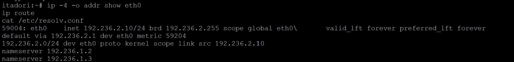

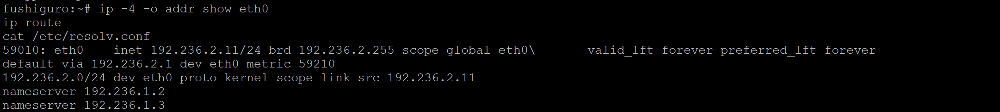

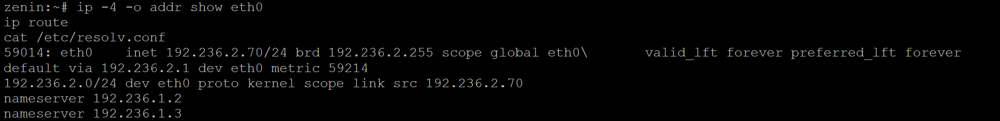

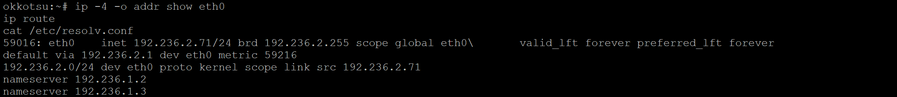

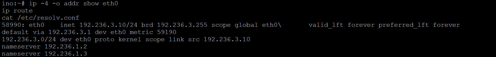

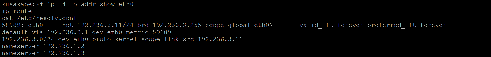

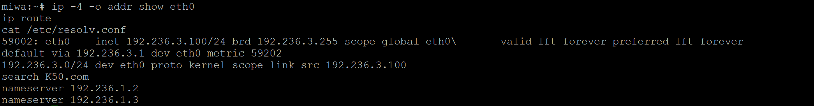

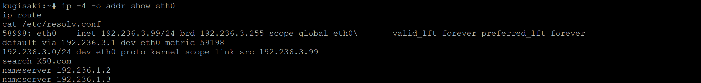

Rekap seluruh client:

| Client    | IP / mask        | Broadcast     | Gateway     | DNS        | Search  | Kebijakan                          |
| --------- | ---------------- | ------------- | ----------- | ---------- | ------- | ---------------------------------- |
| itadori   | 192.236.2.10/24  | 192.236.2.255 | 192.236.2.1 | .1.2, .1.3 | K50.com | Pool 1 (.2.10 sampai .2.35)        |
| fushiguro | 192.236.2.11/24  | 192.236.2.255 | 192.236.2.1 | .1.2, .1.3 | K50.com | Pool 1                             |
| zenin     | 192.236.2.70/24  | 192.236.2.255 | 192.236.2.1 | .1.2, .1.3 | K50.com | Pool 2 (.2.70 sampai .2.95)        |
| okkotsu   | 192.236.2.71/24  | 192.236.2.255 | 192.236.2.1 | .1.2, .1.3 | K50.com | Pool 2                             |
| ino       | 192.236.3.10/24  | 192.236.3.255 | 192.236.3.1 | .1.2, .1.3 | K50.com | Short lease (.3.10 sampai .3.89)   |
| kusakabe  | 192.236.3.11/24  | 192.236.3.255 | 192.236.3.1 | .1.2, .1.3 | K50.com | Short lease                        |
| miwa      | 192.236.3.100/24 | 192.236.3.255 | 192.236.3.1 | .1.2, .1.3 | K50.com | Long lease (.3.100 sampai .3.199)  |
| kugisaki  | 192.236.3.99/24  | 192.236.3.255 | 192.236.3.1 | .1.2, .1.3 | K50.com | Fixed address                      |

#### Cocokkan dengan `dhcpd.leases` di tengen (`/root/soal07-tengen.sh`)

File lease mencatat riwayat, jadi satu IP bisa muncul berkali-kali. Script berikut mengambil entri terakhir tiap IP:

```bash
#!/bin/bash
awk '
/^lease /            { ip=$2; state=""; mac=""; ends="" }
/^  ends /           { ends=$3" "$4; sub(";","",ends) }
/^  binding state /  { state=$3; sub(";","",state) }
/hardware ethernet / { mac=$3; sub(";","",mac) }
/^}/                 { if (ip!="") { S[ip]=state; M[ip]=mac; E[ip]=ends } }
END { for (i in S) printf "%-15s %-18s %-7s ends %s UTC\n", i, M[i], S[i], E[i] }
' /var/lib/dhcp/dhcpd.leases | sort -t. -k3,3n -k4,4n
```

```bash
bash /root/soal07-tengen.sh
grep -cE "^lease 192\.236\.2\.(3[6-9]|[45][0-9]|6[0-9]) " /var/lib/dhcp/dhcpd.leases
```

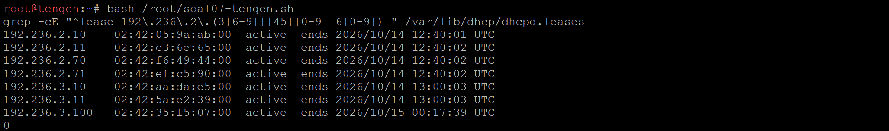

- Pasangan IP dan MAC di server sama dengan yang terlihat di client, dan tiap IP hanya dipegang satu MAC, jadi tidak ada alamat yang bertabrakan.
- Jumlah lease di rentang terlarang `.2.36` sampai `.2.69` adalah `0`.
- kugisaki tidak muncul di file ini. `dhcpd` tidak mencatat alamat `fixed-address` ke `dhcpd.leases`, sehingga reservasinya dibuktikan dari sisi client (soal 6).

----

### Soal 8: Packet Capture Proses DORA
> Sebelum Curtain dibuka kembali, buktikan bahwa proses pemberian alamat berjalan sesuai protokol. Lakukan packet capture saat salah satu client Network 2 atau Network 3 meminta lease baru. Gunakan tcpdump pada tengen atau jalur menuju Data Center untuk menunjukkan urutan DHCPDISCOVER → DHCPOFFER → DHCPREQUEST → DHCPACK. Identifikasi alamat server, alamat yang diberikan, lease time, dan field giaddr. Pastikan nilai giaddr sesuai dengan interface jichi yang menerima request dari subnet client.

#### Script capture di tengen (`/root/soal08-tengen.sh`)

```bash
#!/bin/bash
# Filter chaddr (udp[36:6]) supaya renew client lain tidak ikut tertangkap.
timeout 60 tcpdump -i eth0 -n -vvv -c 4 \
    'udp port 67 and udp[36:4] = 0x0242059a and udp[40:2] = 0xab00' 2>&1 | tee /root/soal08-dora.txt

echo "===== RINGKASAN ====="
grep -E "DHCP-Message|Your-IP|Gateway-IP|Server-ID|Lease-Time" /root/soal08-dora.txt
```

Filter `udp[36:6]` mencocokkan field `chaddr` dengan MAC itadori, supaya paket renew dari client lain tidak ikut terhitung. `timeout 60` membuat capture berhenti sendiri kalau dalam 60 detik tidak ada paket.

#### Urutan pengujian

```bash
ifdown eth0                     # 1. itadori: lepas lease lama
bash /root/soal08-tengen.sh     # 2. tengen: mulai capture
ifup eth0                       # 3. itadori: minta lease baru (dalam 60 detik)
```

`ifdown` dijalankan lebih dulu supaya paket DHCPRELEASE tidak ikut masuk ke dalam empat paket yang ditangkap.

#### Hasil capture

Paket Discover dan Offer:

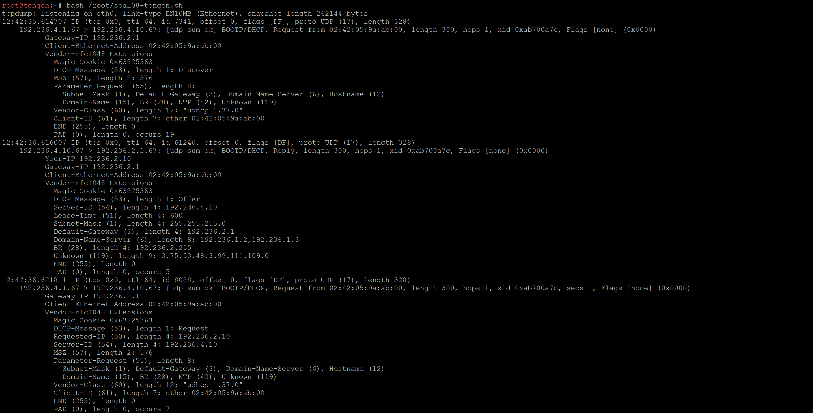

Paket Request, ACK, dan ringkasan:

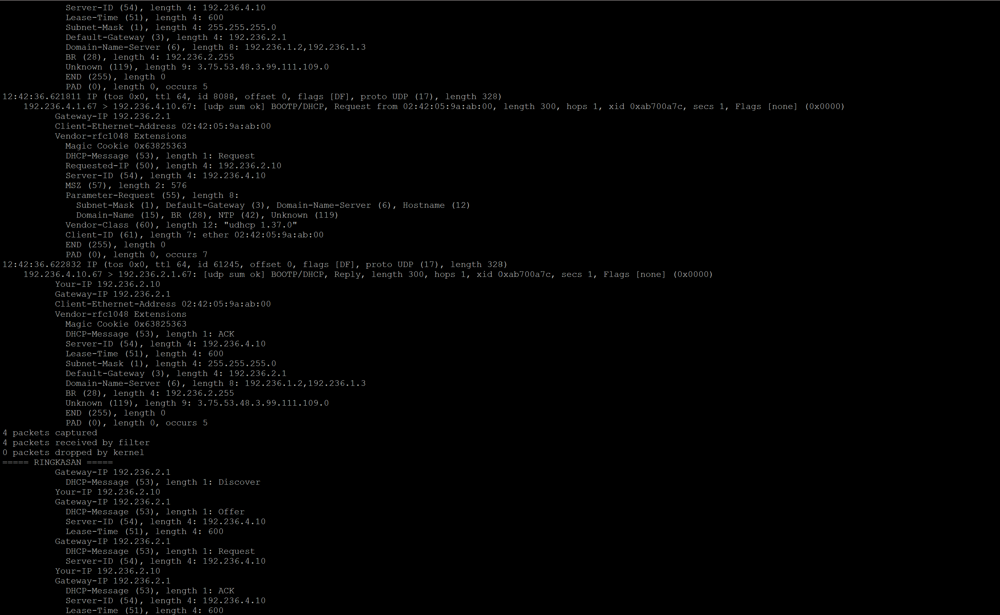

#### Analisis

| Field                 | Nilai                            | Keterangan                                       |
| --------------------- | -------------------------------- | ------------------------------------------------ |
| Urutan pesan          | Discover → Offer → Request → ACK | Keempatnya memakai `xid 0xab700a7c` yang sama    |
| Alamat server         | 192.236.4.10                     | Server-ID (option 54), yaitu tengen              |
| Alamat yang diberikan | 192.236.2.10                     | `Your-IP` (yiaddr), dari Pool 1 milik itadori    |
| Lease time            | 600 detik                        | Option 51, sesuai `default-lease-time` Network 2 |
| giaddr                | 192.236.2.1                      | `Gateway-IP`, yaitu `eth2` jichi                 |

Nilai giaddr `192.236.2.1` adalah alamat `eth2` jichi, interface yang menerima broadcast dari itadori di Network 2. Dari nilai inilah tengen tahu bahwa request berasal dari subnet `192.236.2.0/24` dan harus dilayani dari scope Network 2. Paket Discover dan Request tiba dari `192.236.4.1` (alamat `eth4` jichi) dengan `hops 1`, dan balasan server dikirim unicast ke `192.236.2.1`, yang menunjukkan request memang lewat relay.

Option `Unknown (119), length 9: 3.75.53.48.3.99.111.109.0` adalah domain-search `K50.com` dalam format label DNS: `3` diikuti `75.53.48` (`K50`), `3` diikuti `99.111.109` (`com`), lalu `0` sebagai penutup.

----

### Soal 9: Simulasi Gangguan DHCP Relay
> Sebuah gangguan memutus jalur relay dan membuat permintaan alamat tidak sampai ke Data Center. Hentikan service DHCP Relay pada jichi, lalu paksa salah satu client di Network 2 atau Network 3 meminta lease baru dan catat gejalanya. Pulihkan service relay, ulangi permintaan DHCP, lalu buktikan bahwa client kembali memperoleh alamat dari pool yang benar dengan gateway semula.

#### Script di jichi (`/root/soal09-jichi.sh`)

```bash
#!/bin/bash
# Pemakaian: bash /root/soal09-jichi.sh down   -> hentikan relay
#            bash /root/soal09-jichi.sh up     -> pulihkan relay
case "$1" in
    down) service isc-dhcp-relay stop ;;
    up)   pgrep -x dhcrelay >/dev/null || rm -f /var/run/dhcrelay.pid
          service isc-dhcp-relay start ;;
    *)    echo "pemakaian: $0 down|up"; exit 1 ;;
esac
service isc-dhcp-relay status
pgrep -a dhcrelay || echo "dhcrelay tidak berjalan"
```

#### Script di client ino (`/root/soal09-client.sh`)

```sh
#!/bin/sh
ifdown eth0 2>/dev/null          # lepas lease lama
ip addr flush dev eth0
ip link set eth0 up              # ifdown mematikan link, nyalakan lagi sebelum udhcpc
if udhcpc -i eth0 -n -q -t 3 -T 2 -O search; then
    ifup eth0                    # kembali ke mode normal (udhcpc jalan di background)
else
    echo ">> GAGAL: tidak ada DHCPOFFER (relay mati?)"
fi
ip -br a show eth0
ip route
```

`udhcpc -n -t 3 -T 2` membatasi client mencoba tiga kali dengan jeda dua detik, lalu menyerah. Tanpa batas ini, client akan terus mencoba tanpa henti saat relay mati.

#### Hentikan relay, lalu minta lease dari ino

```bash
bash /root/soal09-jichi.sh down     # jichi
```

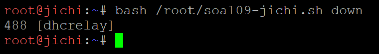

```bash
sh /root/soal09-client.sh           # ino
```

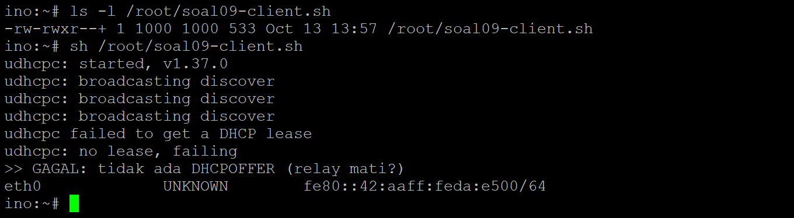

Gejala: ino mengirim DHCPDISCOVER tiga kali tanpa pernah menerima DHCPOFFER, `eth0` tidak punya alamat IPv4, dan tabel routing kosong (tidak ada default gateway). Broadcast client berhenti di jichi karena tidak ada lagi yang meneruskannya ke tengen.

Setelah `down`, script jichi bisa saja masih menampilkan satu baris PID `dhcrelay`. Itu proses yang baru dihentikan dan belum hilang dari tabel proses saat `pgrep` berjalan. Relay benar-benar berhenti, terlihat dari ino yang gagal mendapat lease.

#### Pulihkan relay, lalu ulangi dari ino

```bash
bash /root/soal09-jichi.sh up       # jichi
```

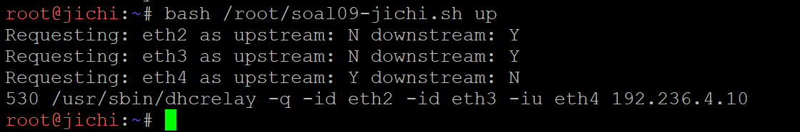

```bash
sh /root/soal09-client.sh           # ino
ping -c 2 192.236.3.1
cat /etc/resolv.conf
```

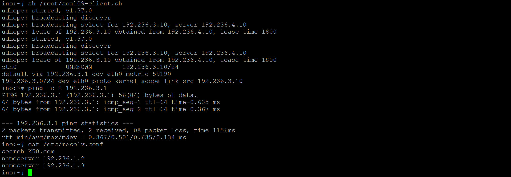

Setelah relay pulih, ino kembali mendapat alamat dari pool short lease (`.3.10` sampai `.3.89`) dengan lease 1800 detik, gateway `192.236.3.1` seperti sebelum gangguan, dan DNS serta domain-search kembali terpasang.

----

### Soal 10: Autostart dan Ketahanan Setelah Restart
> Setelah gangguan Shibuya tertangani, pastikan pemulihan bertahan setelah restart. Aktifkan autostart DHCP Server pada tengen dan DHCP Relay pada jichi, lalu restart kedua node. Verifikasi status layanan, IP, gateway, lease, dan konektivitas client Network 2–3. Pastikan kebijakan Pool 1, Pool 2, short lease, long lease, dan fixed address tetap berlaku.

Image `debinet` tidak memakai systemd, sehingga `systemctl enable` tidak tersedia. Sebagai gantinya, image ini menjalankan `/root/init.sh` secara otomatis setiap node boot, dan direktori `/root` serta `/etc/network` tersimpan permanen. Autostart dipasang di file tersebut.

#### `/root/init.sh` di tengen

```bash
#!/bin/bash
bash /root/soal06-tengen.sh > /root/init.log 2>&1
```

#### `/root/init.sh` di jichi

```bash
#!/bin/bash
{
    bash /root/soal01-jichi.sh
    bash /root/soal03-jichi.sh
} > /root/init.log 2>&1
```

```bash
chmod +x /root/init.sh
```

Script yang dipanggil memeriksa dulu apakah paketnya sudah terpasang, menulis ulang konfigurasi, lalu menyalakan layanan, sehingga aman dijalankan berulang kali. Ketika container node dibuat ulang (misalnya saat project dibuka kembali), paket `isc-dhcp-relay` dan `isc-dhcp-server` ikut hilang; `init.sh` memasangnya ulang secara otomatis lewat internet, lalu menyalakan layanannya tanpa perintah manual.

#### Restart jichi dan tengen, lalu verifikasi

Seluruh node di-stop lalu di-start dari GNS3. Tanpa menjalankan perintah apa pun secara manual:

```bash
ip -br a                            # jichi
sysctl net.ipv4.ip_forward
iptables -t nat -S POSTROUTING
ps -e -o pid,args | grep dhcrelay
cat /etc/default/isc-dhcp-relay
```

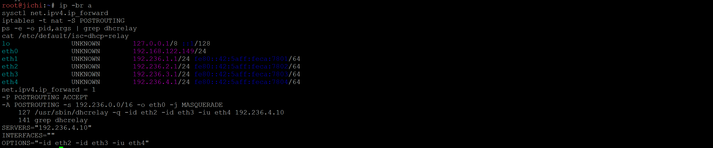

```bash
ip -br a show eth0                  # tengen
ip route
service isc-dhcp-server status
ps -e -o pid,args | grep dhcpd
```

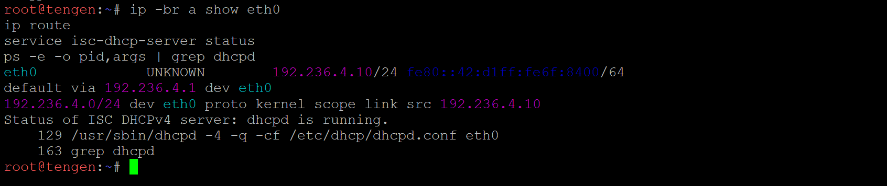

IP, forwarding, NAT, relay di jichi, dan DHCP server di tengen langsung aktif setelah boot. PID `dhcrelay` dan `dhcpd` yang kecil menunjukkan keduanya dinyalakan oleh `init.sh` sejak awal boot.

#### Minta lease ulang di client

Satu client untuk tiap kebijakan:

```bash
ifdown eth0; ifup eth0
ip route
ping -c 2 192.236.X.1
ping -c 2 8.8.8.8
```

Pool 1 (itadori):

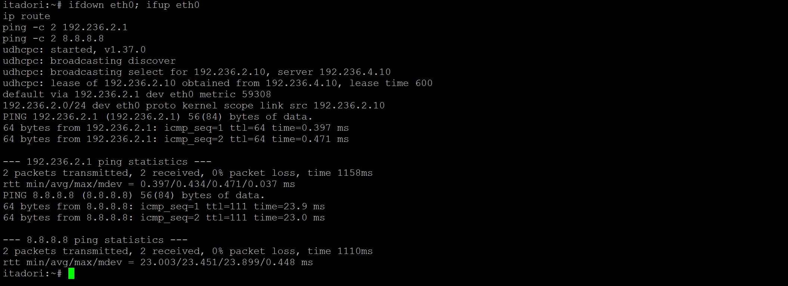

Pool 2 (zenin):

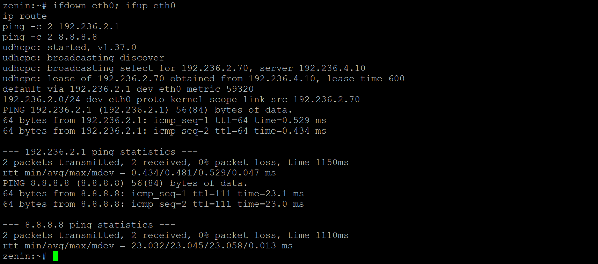

Short lease (ino):

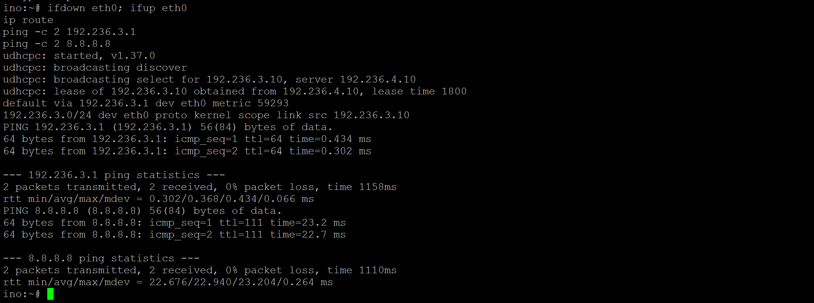

Long lease (miwa):

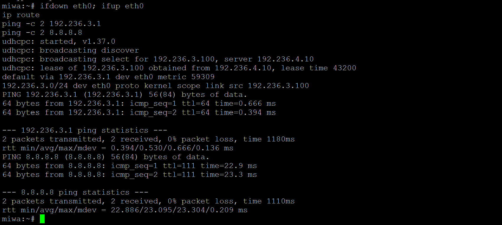

Fixed address (kugisaki):

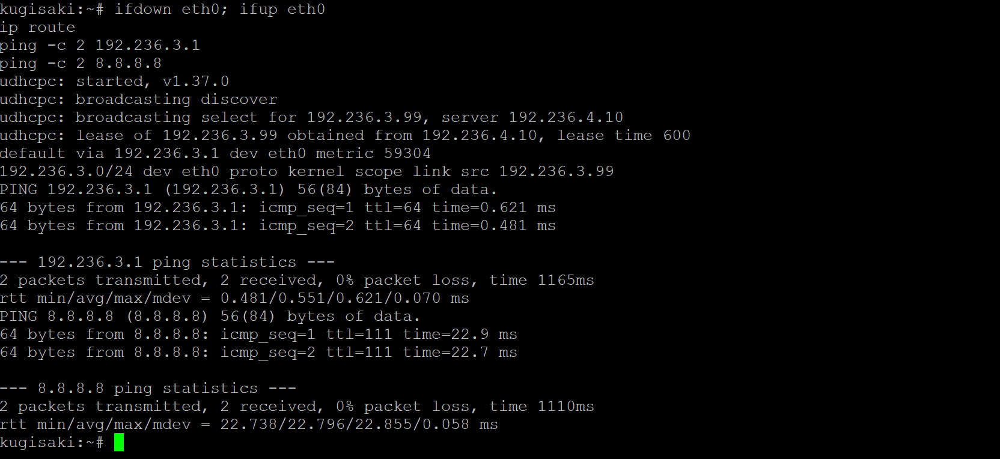

| Client   | IP            | Lease | Gateway     | Ping gateway | Ping 8.8.8.8 | Kebijakan     |
| -------- | ------------- | ----- | ----------- | ------------ | ------------ | ------------- |
| itadori  | 192.236.2.10  | 600   | 192.236.2.1 | ok           | ok           | Pool 1        |
| zenin    | 192.236.2.70  | 600   | 192.236.2.1 | ok           | ok           | Pool 2        |
| ino      | 192.236.3.10  | 1800  | 192.236.3.1 | ok           | ok           | Short lease   |
| miwa     | 192.236.3.100 | 43200 | 192.236.3.1 | ok           | ok           | Long lease    |
| kugisaki | 192.236.3.99  | 600   | 192.236.3.1 | ok           | ok           | Fixed address |

#### Lease di tengen setelah restart

```bash
bash /root/soal07-tengen.sh
```

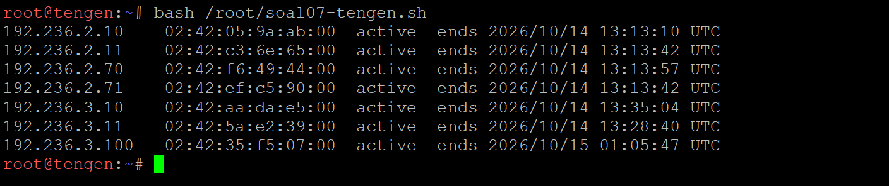

Setelah restart, DHCP Server dan DHCP Relay hidup sendiri, setiap client menerima alamat dari pool yang benar, dan seluruh kebijakan (Pool 1, Pool 2, short lease, long lease, fixed address) tetap berlaku.

----

### Soal 11:
> Utahime dan Shoko ditugaskan membangun sistem penamaan domain resmi agar seluruh pos tidak perlu menghafal alamat IP mentah. Konfigurasikan BIND9 pada utahime sebagai DNS Master dan shoko sebagai DNS Slave untuk mengelola domain jujutsu.<xxxx>.com. Atur SOA record, NS delegasi untuk kedua server, dan terapkan allow-transfer dari Master ke Slave. Pastikan file zona berhasil tersinkronisasi otomatis ke shoko saat nomor serial di utahime dinaikkan, lalu buktikan dengan melakukan query dig ke kedua server dari salah satu client.

#### Cek kesiapan node **utahime** dan **shoko**

```bash
named -v
ip -br a show eth0
```


#### Konfigurasi DNS Master **utahime**

```bash
mkdir -p /etc/bind/zones

cat > /etc/bind/named.conf.options << 'EOF'
options {
    directory "/var/cache/bind";
    listen-on { any; };
    listen-on-v6 { none; };
    allow-query { any; };
    recursion yes;
    allow-recursion { 127.0.0.1; 192.236.0.0/16; };
    dnssec-validation no;
};
EOF

cat > /etc/bind/named.conf.local << 'EOF'
zone "jujutsu.K50.com" {
    type primary;
    file "/etc/bind/zones/db.jujutsu.K50.com";
    notify yes;
    also-notify { 192.236.1.3; };
    allow-transfer { 192.236.1.3; };
};
EOF

cat > /etc/bind/zones/db.jujutsu.K50.com << 'EOF'
$TTL 3600
@       IN      SOA     utahime.jujutsu.K50.com. admin.jujutsu.K50.com. (
                        2026101401
                        3600
                        900
                        1209600
                        300 )

@       IN      NS      utahime.jujutsu.K50.com.
@       IN      NS      shoko.jujutsu.K50.com.

utahime IN      A       192.236.1.2
shoko   IN      A       192.236.1.3
EOF

chown -R root:bind /etc/bind/zones
chmod 755 /etc/bind/zones
chmod 644 /etc/bind/zones/db.jujutsu.K50.com

named-checkconf && echo "named.conf OK"
named-checkzone jujutsu.K50.com /etc/bind/zones/db.jujutsu.K50.com
```


#### Jalankan BIND di utahime

```bash
service named restart
sleep 2
pgrep -a named
ss -ulnp | grep :53
ss -tlnp | grep :53
dig @127.0.0.1 jujutsu.K50.com SOA +short
```


#### Konfigurasi DNS Slave **shoko**

```bash
cat > /etc/bind/named.conf.options << 'EOF'
options {
    directory "/var/cache/bind";
    listen-on { any; };
    listen-on-v6 { none; };
    allow-query { any; };
    recursion yes;
    allow-recursion { 127.0.0.1; 192.236.0.0/16; };
    dnssec-validation no;
    masterfile-format text;
};
EOF

cat > /etc/bind/named.conf.local << 'EOF'
zone "jujutsu.K50.com" {
    type secondary;
    file "/var/cache/bind/db.jujutsu.K50.com";
    primaries { 192.236.1.2; };
    allow-transfer { none; };
};
EOF

chown -R bind:bind /var/cache/bind
named-checkconf && echo "named.conf OK"
```


#### Jalankan BIND di shoko dan cek hasil transfer

```bash
service named restart
sleep 5
pgrep -a named
ls -l /var/cache/bind/
dig @127.0.0.1 jujutsu.K50.com SOA +short
cat /var/cache/bind/db.jujutsu.K50.com
```


#### Uji dari client (kondisi awal) **itadori**

```bash
dig @192.236.1.2 jujutsu.K50.com SOA +short
dig @192.236.1.3 jujutsu.K50.com SOA +short
dig @192.236.1.2 jujutsu.K50.com NS +short
dig @192.236.1.3 jujutsu.K50.com NS +short
dig @192.236.1.2 jujutsu.K50.com SOA | grep flags
dig @192.236.1.3 jujutsu.K50.com SOA | grep flags
```


#### Uji sinkronisasi otomatis (naikkan serial di Master) **utahime**

```bash
cat >> /etc/bind/zones/db.jujutsu.K50.com << 'EOF'
gojo    IN      A       192.236.1.4
EOF

sed -i 's/2026101401/2026101402/' /etc/bind/zones/db.jujutsu.K50.com
named-checkzone jujutsu.K50.com /etc/bind/zones/db.jujutsu.K50.com
rndc reload jujutsu.K50.com
sleep 3
dig @127.0.0.1 jujutsu.K50.com SOA +short
```


#### Selanjutnya cek di slave **shoko**

```bash
sleep 3
dig @127.0.0.1 jujutsu.K50.com SOA +short
dig @127.0.0.1 gojo.jujutsu.K50.com +short
grep gojo /var/cache/bind/db.jujutsu.K50.com
```


Terakhir, bukti dari client **itadori**

```bash
for s in 192.236.1.2 192.236.1.3; do echo -n "$s -> serial "; dig +short SOA jujutsu.K50.com @$s | awk '{print $3}'; done
dig @192.236.1.2 gojo.jujutsu.K50.com +short
dig @192.236.1.3 gojo.jujutsu.K50.com +short
```


#### Uji pembatasan zone transfer

shoko *harus diizinkan*

```bash
dig AXFR jujutsu.K50.com @192.236.1.2
```


itadori *harus ditolak*

```bash
dig AXFR jujutsu.K50.com @192.236.1.2
```


#### Autostart BIND saat node restart **utahime** dan **shoko**

```bash
mkdir -p /root/boot.d
echo 'service named start' > /root/boot.d/named.sh
cat /root/boot.d/named.sh
```


----

### Soal 12:
> Peta domain harus memetakan pintu masuk utama dan tetap bisa mencari alamat di luar kawasan Shibuya. Pada utahime, buat A record jujutsu.<xxxx>.com yang mengarah ke gojo, serta CNAME www yang merujuk ke domain utama tersebut. Buat pula Reverse DNS (zona PTR) untuk melacak IP gojo kembali ke domain resminya, dan aktifkan fitur DNS Forwarder pada BIND9 mengarah ke IP gateway internet (192.168.122.1). Uji dari client dengan dig untuk mengecek CNAME, PTR, dan buktikan client tetap bisa melakukan ping ke domain internet seperti google.com.

#### Perbarui zona utama

**utahime**

```bash
cat > /etc/bind/zones/db.jujutsu.K50.com << 'EOF'
$TTL 3600
@       IN      SOA     utahime.jujutsu.K50.com. admin.jujutsu.K50.com. (
                        2026101403
                        3600
                        900
                        1209600
                        300 )

@       IN      NS      utahime.jujutsu.K50.com.
@       IN      NS      shoko.jujutsu.K50.com.

@       IN      A       192.236.1.4
www     IN      CNAME   jujutsu.K50.com.

utahime IN      A       192.236.1.2
shoko   IN      A       192.236.1.3
gojo    IN      A       192.236.1.4
EOF

named-checkzone jujutsu.K50.com /etc/bind/zones/db.jujutsu.K50.com
```


#### Buat reverse zone

**utahime**

```bash
cat > /etc/bind/named.conf.local << 'EOF'
zone "jujutsu.K50.com" {
    type primary;
    file "/etc/bind/zones/db.jujutsu.K50.com";
    notify yes;
    also-notify { 192.236.1.3; };
    allow-transfer { 192.236.1.3; };
};

zone "1.236.192.in-addr.arpa" {
    type primary;
    file "/etc/bind/zones/db.1.236.192";
};
EOF

cat > /etc/bind/zones/db.1.236.192 << 'EOF'
$TTL 3600
@       IN      SOA     utahime.jujutsu.K50.com. admin.jujutsu.K50.com. (
                        2026101401
                        3600
                        900
                        1209600
                        300 )

@       IN      NS      utahime.jujutsu.K50.com.

4       IN      PTR     jujutsu.K50.com.
EOF

chown -R root:bind /etc/bind/zones
chmod 644 /etc/bind/zones/db.1.236.192

named-checkzone 1.236.192.in-addr.arpa /etc/bind/zones/db.1.236.192
```


#### Aktifkan DNS Forwarder

**utahime**

```bash
cat > /etc/bind/named.conf.options << 'EOF'
options {
    directory "/var/cache/bind";
    listen-on { any; };
    listen-on-v6 { none; };
    allow-query { any; };
    recursion yes;
    allow-recursion { 127.0.0.1; 192.236.0.0/16; };
    forwarders { 192.168.122.1; };
    forward first;
    dnssec-validation no;
};
EOF

named-checkconf && echo "named.conf OK"
```


#### Restart BIND dan cek lokal

**utahime**

```bash
service named restart
sleep 3
dig @127.0.0.1 jujutsu.K50.com SOA +short
dig @127.0.0.1 jujutsu.K50.com +short
dig @127.0.0.1 www.jujutsu.K50.com +noall +answer
dig @127.0.0.1 -x 192.236.1.4 +noall +answer
dig @127.0.0.1 google.com +short
```


#### Aktifkan forwarder di Slave dan pastikan zona tersinkron

**shoko**

```bash
cat > /etc/bind/named.conf.options << 'EOF'
options {
    directory "/var/cache/bind";
    listen-on { any; };
    listen-on-v6 { none; };
    allow-query { any; };
    recursion yes;
    allow-recursion { 127.0.0.1; 192.236.0.0/16; };
    forwarders { 192.168.122.1; };
    forward first;
    dnssec-validation no;
    masterfile-format text;
};
EOF

named-checkconf && echo "named.conf OK"
service named restart
sleep 5
dig @127.0.0.1 jujutsu.K50.com SOA +short
dig @127.0.0.1 www.jujutsu.K50.com +noall +answer
dig @127.0.0.1 google.com +short
```


#### Uji dari client

**itadori**

```bash
dig @192.236.1.2 jujutsu.K50.com +short
dig @192.236.1.3 jujutsu.K50.com +short
dig www.jujutsu.K50.com +noall +answer
dig -x 192.236.1.4 +noall +answer
dig -x 192.236.1.4 | grep flags
ping -c 2 google.com
```


#### Uji dari client lain

**kusakabe**

```bash
dig www.jujutsu.K50.com +short
dig -x 192.236.1.4 +short
ping -c 2 google.com
```


----

### Soal 13:
> Kepala Sekolah Yaga dan Inumaki mendirikan database terpusat yang redundan agar log aktivitas kutukan tetap aman tersimpan. Konfigurasikan MariaDB pada yaga sebagai DB-Master dan inumaki sebagai DB-Slave. Buat database db_shibuya_<xxxx> beserta tabel request_logs di Master, aktifkan binary logging (log-bin, server-id), lalu hubungkan inumaki sebagai Slave yang menyalin data secara realtime dengan CHANGE MASTER TO. Berikan hak akses remote bagi seluruh node di Network 4, lalu buktikan replikasi berhasil dengan memasukkan data baru di Master dan memeriksa hasilnya di Slave.

#### Cek kesiapan node

**yaga** dan **inumaki**

```bash
mariadbd --version
ip -br a show eth0
ls /var/lib/mysql | head -5
```


#### Konfigurasi dan jalankan Master

**yaga**

```bash
cat > /etc/mysql/mariadb.conf.d/99-replication.cnf << 'EOF'
[mysqld]
bind-address = 0.0.0.0
skip-name-resolve
server-id = 1
log_bin = /var/lib/mysql/mysql-bin
EOF

mkdir -p /run/mysqld
chown mysql:mysql /run/mysqld
service mariadb restart
sleep 5
pgrep -a mariadbd
ss -tlnp | grep 3306
mariadb -e "SHOW VARIABLES WHERE Variable_name IN ('server_id','log_bin');"
```


#### Buat user replikasi

**yaga**

```bash
mariadb -e "CREATE USER 'repl'@'192.236.4.21' IDENTIFIED BY 'replpass50'; GRANT REPLICATION SLAVE ON *.* TO 'repl'@'192.236.4.21'; FLUSH PRIVILEGES;"
mariadb -t -e "SELECT user, host FROM mysql.user WHERE user='repl';"
```


#### Buat database, tabel, dan user remote Network 4

**yaga**

```bash
mariadb << 'EOF'
CREATE DATABASE db_shibuya_K50;
USE db_shibuya_K50;
CREATE TABLE request_logs (
    id INT AUTO_INCREMENT PRIMARY KEY,
    worker VARCHAR(50) NOT NULL,
    client_ip VARCHAR(45) DEFAULT NULL,
    path VARCHAR(255) DEFAULT NULL,
    created_at TIMESTAMP DEFAULT CURRENT_TIMESTAMP
);
CREATE USER 'shibuya'@'192.236.4.%' IDENTIFIED BY 'shibuya50';
GRANT ALL PRIVILEGES ON db_shibuya_K50.* TO 'shibuya'@'192.236.4.%';
FLUSH PRIVILEGES;
EOF

mariadb -t -e "SHOW DATABASES LIKE 'db_shibuya%'; DESCRIBE db_shibuya_K50.request_logs;"
mariadb -t -e "SELECT user, host FROM mysql.user WHERE user IN ('shibuya','repl');"
```


#### Cek file binlog di Master

**yaga**

```bash
mariadb -t -e "SHOW BINARY LOGS; SHOW MASTER STATUS;"
```


#### Konfigurasi dan jalankan Slave

**inumaki**

```bash
cat > /etc/mysql/mariadb.conf.d/99-replication.cnf << 'EOF'
[mysqld]
bind-address = 0.0.0.0
skip-name-resolve
server-id = 2
relay_log = /var/lib/mysql/relay-bin
read_only = 1
EOF

mkdir -p /run/mysqld
chown mysql:mysql /run/mysqld
service mariadb restart
sleep 5
pgrep -a mariadbd
mariadb -e "SHOW VARIABLES WHERE Variable_name IN ('server_id','read_only');"
```


#### Hubungkan Slave ke Master

**inumaki**

```bash
mariadb -e "CHANGE MASTER TO MASTER_HOST='192.236.4.20', MASTER_USER='repl', MASTER_PASSWORD='replpass50', MASTER_LOG_FILE='mysql-bin.000001', MASTER_LOG_POS=4; START SLAVE;"
sleep 5
mariadb -e "SHOW SLAVE STATUS\G" | egrep "Slave_IO_State|Master_Host|Master_Log_File|Read_Master_Log_Pos|Slave_IO_Running|Slave_SQL_Running|Seconds_Behind_Master|Last_IO_Error|Last_SQL_Error"
```


#### Cek DB, tabel, dan user sudah tereplikasi

**inumaki**

```bash
mariadb -t -e "SHOW DATABASES LIKE 'db_shibuya%'; DESCRIBE db_shibuya_K50.request_logs;"
mariadb -t -e "SELECT user, host FROM mysql.user WHERE user IN ('shibuya','repl');"
```


#### Bukti replikasi, insert di Master, cek di Slave

**yaga**

```bash
mariadb -e "INSERT INTO db_shibuya_K50.request_logs (worker, client_ip, path) VALUES ('uji-replikasi-1','192.236.2.10','/tes1'),('uji-replikasi-2','192.236.3.10','/tes2');"
mariadb -t -e "SELECT * FROM db_shibuya_K50.request_logs;"
mariadb -t -e "SHOW MASTER STATUS;"
```


**inumaki**

```bash
sleep 2
mariadb -t -e "SELECT * FROM db_shibuya_K50.request_logs;"
mariadb -e "SHOW SLAVE STATUS\G" | egrep "Read_Master_Log_Pos|Exec_Master_Log_Pos|Seconds_Behind_Master"
```


#### Tes hak akses remote dari node Network 4

**nanami**

```bash
mariadb -h 192.236.4.20 -u shibuya -pshibuya50 -e "SELECT worker, path FROM db_shibuya_K50.request_logs;"
mariadb -h 192.236.4.21 -u shibuya -pshibuya50 -e "SELECT worker, path FROM db_shibuya_K50.request_logs;"
```


#### Autostart MariaDB saat node restart
/run hilang tiap boot, jadi folder /run/mysqld harus dibuat ulang oleh script boot.

**yaga** dan **inumaki**

```bash
mkdir -p /root/boot.d
cat > /root/boot.d/mariadb.sh << 'EOF'
mkdir -p /run/mysqld
chown mysql:mysql /run/mysqld
service mariadb start
EOF
cat /root/boot.d/mariadb.sh
```


----

### Soal 14:
> Para penyihir lapangan bersiaga di Data Center sebagai pekerja backend untuk memproses aplikasi. Pasang Nginx dan PHP-FPM pada maki dan panda untuk menyajikan web frontend yang menampilkan hostname masing-masing. Pada nanami, todo, dan kirara, siapkan layanan API yang mencatat log request ke database yaga. Konfigurasikan virtual host agar worker merespons domain layanan yang ditentukan. Batasi akses langsung dari klien ke worker, web worker hanya menerima trafik melalui jalur proxy web yang ditentukan, sedangkan worker API hanya menerima trafik melalui geto. Uji bahwa akses langsung dari klien ditolak, sementara akses melalui reverse proxy tetap berhasil.


#### Worker frontend

**maki** dan **panda**

```bash
cat > /root/setup-web.sh << 'SETUP_EOF'
#!/bin/bash
# /root/setup-web.sh - Worker frontend (maki, panda): nginx + php-fpm
GOJO="192.236.1.4"
PHPV=$(ls /usr/sbin/php-fpm[0-9]* 2>/dev/null | head -1 | sed 's/.*php-fpm//')
[ -z "$PHPV" ] && { echo "php-fpm tidak ditemukan"; exit 1; }
NODE=$(hostname)

# 1. Halaman frontend (menampilkan hostname)
mkdir -p /var/www/frontend
cat > /var/www/frontend/index.php <<'PHPEOF'
<?php
echo "<h1>Jujutsu High - Frontend</h1>\n";
echo "<p>Worker: " . htmlspecialchars(gethostname()) . "</p>\n";
PHPEOF
chown -R www-data:www-data /var/www/frontend

# 2. Virtual host: hanya gojo yang boleh masuk
rm -f /etc/nginx/sites-enabled/default
cat > /etc/nginx/sites-available/jujutsu-frontend <<NGEOF
server {
    listen 80 default_server;
    server_name jujutsu.K50.com www.jujutsu.K50.com;
    root /var/www/frontend;
    index index.php;

    allow ${GOJO};
    deny all;

    location / {
        try_files \$uri \$uri/ /index.php?\$query_string;
    }
    location ~ \.php\$ {
        include snippets/fastcgi-php.conf;
        fastcgi_pass unix:/run/php/php${PHPV}-fpm.sock;
    }
}
NGEOF
ln -sf /etc/nginx/sites-available/jujutsu-frontend /etc/nginx/sites-enabled/jujutsu-frontend

# 3. Jalankan service
mkdir -p /run/php
service php${PHPV}-fpm restart
nginx -t || exit 1
service nginx restart

# 4. Autostart saat boot (dipanggil init.sh lewat boot.d)
mkdir -p /root/boot.d
cat > /root/boot.d/web.sh <<BOOTEOF
mkdir -p /run/php
service php${PHPV}-fpm start
service nginx start
BOOTEOF

# 5. Ringkasan
sleep 2
echo "===== HASIL $NODE ====="
echo "hostname      : $NODE"
echo "PHP-FPM versi : $PHPV"
nginx -t 2>&1 | tail -2
pgrep -a php-fpm | head -2
ss -tlnp | grep ':80 '
ls /run/php/
echo -n "akses lokal (harus 403) : "; curl -s -o /dev/null -w "%{http_code}\n" http://127.0.0.1/
SETUP_EOF

bash -n /root/setup-web.sh && echo "script OK" && bash /root/setup-web.sh
```


#### Worker API

**nanami**, **todo** dan **kirara**

```bash
cat > /root/setup-api.sh << 'SETUP_EOF'
#!/bin/bash
# /root/setup-api.sh - Worker API (nanami, todo, kirara): nginx + php-fpm + log ke yaga
GETO="192.236.4.2"
DBHOST="192.236.4.20"
PHPV=$(ls /usr/sbin/php-fpm[0-9]* 2>/dev/null | head -1 | sed 's/.*php-fpm//')
[ -z "$PHPV" ] && { echo "php-fpm tidak ditemukan"; exit 1; }
NODE=$(hostname)

# 1. Skrip API: catat request ke request_logs di yaga
mkdir -p /var/www/api
cat > /var/www/api/index.php <<'PHPEOF'
<?php
header('Content-Type: application/json');
mysqli_report(MYSQLI_REPORT_OFF);

$worker = gethostname();
$client = $_SERVER['REMOTE_ADDR'] ?? '';
$path   = $_SERVER['REQUEST_URI'] ?? '';

$db = mysqli_init();
$db->options(MYSQLI_OPT_CONNECT_TIMEOUT, 3);
if (!@$db->real_connect('192.236.4.20', 'shibuya', 'shibuya50', 'db_shibuya_K50')) {
    http_response_code(500);
    echo json_encode(['status' => 'error', 'worker' => $worker, 'message' => 'koneksi database gagal']);
    exit;
}
$stmt = $db->prepare('INSERT INTO request_logs (worker, client_ip, path) VALUES (?, ?, ?)');
$stmt->bind_param('sss', $worker, $client, $path);
if (!$stmt->execute()) {
    http_response_code(500);
    echo json_encode(['status' => 'error', 'worker' => $worker, 'message' => 'insert gagal']);
    exit;
}
echo json_encode([
    'status'    => 'ok',
    'worker'    => $worker,
    'client_ip' => $client,
    'path'      => $path,
    'log_id'    => $db->insert_id
], JSON_UNESCAPED_SLASHES);
PHPEOF
chown -R www-data:www-data /var/www/api

# 2. Virtual host: hanya geto yang boleh masuk
rm -f /etc/nginx/sites-enabled/default
cat > /etc/nginx/sites-available/jujutsu-api <<NGEOF
server {
    listen 80 default_server;
    server_name jujutsu.K50.com www.jujutsu.K50.com;
    root /var/www/api;

    allow ${GETO};
    deny all;

    location /api {
        include fastcgi_params;
        fastcgi_param SCRIPT_FILENAME /var/www/api/index.php;
        fastcgi_pass unix:/run/php/php${PHPV}-fpm.sock;
    }
}
NGEOF
ln -sf /etc/nginx/sites-available/jujutsu-api /etc/nginx/sites-enabled/jujutsu-api

# 3. Jalankan service
mkdir -p /run/php
service php${PHPV}-fpm restart
nginx -t || exit 1
service nginx restart

# 4. Autostart saat boot
mkdir -p /root/boot.d
cat > /root/boot.d/api.sh <<BOOTEOF
mkdir -p /run/php
service php${PHPV}-fpm start
service nginx start
BOOTEOF

# 5. Ringkasan
sleep 2
echo "===== HASIL $NODE ====="
echo "hostname      : $NODE"
echo "PHP-FPM versi : $PHPV"
echo -n "ekstensi mysqli : "; php-fpm${PHPV} -m | grep -ci mysqli
nginx -t 2>&1 | tail -2
pgrep -a php-fpm | head -2
ss -tlnp | grep ':80 '
mariadb -h $DBHOST -u shibuya -pshibuya50 -N -e "SELECT COUNT(*) FROM db_shibuya_K50.request_logs" >/dev/null 2>&1 \
    && echo "koneksi DB yaga : OK" || echo "koneksi DB yaga : GAGAL"
echo -n "akses lokal /api (harus 403) : "; curl -s -o /dev/null -w "%{http_code}\n" http://127.0.0.1/api
SETUP_EOF

bash -n /root/setup-api.sh && echo "script OK" && bash /root/setup-api.sh
```


#### Uji akses lewat jalur proxy (yang diizinkan)

**gojo, ke worker frontend**

```bash
for h in 192.236.4.3 192.236.4.4; do echo "== $h"; curl -s -H "Host: jujutsu.K50.com" http://$h/; done
```


**geto, ke worker API**

```bash
for h in 192.236.4.5 192.236.4.6 192.236.4.7; do echo "== $h"; curl -s -H "Host: jujutsu.K50.com" http://$h/api; echo; done
```


#### Uji akses langsung dari klien (harus ditolak)

**itadori (Network 2) dan kusakabe (Network 3)**

```bash
for h in 192.236.4.3 192.236.4.4; do echo -n "$h / -> "; curl -s -o /dev/null -w "%{http_code}\n" http://$h/; done
for h in 192.236.4.5 192.236.4.6 192.236.4.7; do echo -n "$h /api -> "; curl -s -o /dev/null -w "%{http_code}\n" http://$h/api; done
echo "--- Host header dipalsukan:"
curl -s -o /dev/null -w "%{http_code}\n" -H "Host: jujutsu.K50.com" http://192.236.4.3/
echo "--- detail respons:"
curl -i http://192.236.4.5/api | head -3
```


Membuktikan worker API benar-benar hanya menerima geto, bukan semua node Network 4
**yaga**

```bash
curl -s -o /dev/null -w "yaga -> nanami /api : %{http_code}\n" http://192.236.4.5/api
curl -s -o /dev/null -w "yaga -> maki /      : %{http_code}\n" http://192.236.4.3/
```


#### Cek log tercatat di database

**yaga**

```bash
mariadb -t -e "SELECT id, worker, client_ip, path, created_at FROM db_shibuya_K50.request_logs ORDER BY id DESC LIMIT 5;"
mariadb -t -e "SELECT worker, COUNT(*) AS total FROM db_shibuya_K50.request_logs GROUP BY worker;"
```


**inumaki**

```bash
mariadb -t -e "SELECT id, worker, client_ip, path FROM db_shibuya_K50.request_logs ORDER BY id DESC LIMIT 5;"
```


#### Cek autostart

**maki, panda, nanami, todo, kirara**

```bash
cat /root/boot.d/*.sh
```


----

### Soal 15:
> Geto bertugas mengendalikan pembagian beban request API di internal Data Center agar server tidak tumbang bersamaan. Konfigurasikan Nginx pada geto sebagai Load Balancer internal dengan upstream api_cluster yang mengarahkan trafik ke nanami dan todo. Terapkan algoritma Weighted Round Robin dengan bobot 3:1, di mana nanami menerima porsi beban tiga kali lebih banyak daripada todo. Buktikan distribusi beban ini dengan melakukan loop request berulang kali ke geto dari jaringan lokal Data Center dan periksa rasio responnya.

#### Cek kesiapan

**geto**

```bash
ip -br a show eth0
ip route | grep default
nginx -v
for h in 192.236.4.5 192.236.4.6; do echo -n "$h : "; curl -s -H "Host: jujutsu.K50.com" http://$h/api; echo; done
```


#### Konfigurasi Load Balancer

**geto**

```bash
cat > /root/setup-geto.sh << 'SETUP_EOF'
#!/bin/bash
# /root/setup-geto.sh - Internal Load Balancer (nginx): upstream api_cluster, WRR 3:1
NANAMI="192.236.4.5"
TODO="192.236.4.6"

rm -f /etc/nginx/sites-enabled/default
cat > /etc/nginx/sites-available/jujutsu-lb <<NGEOF
upstream api_cluster {
    zone api_cluster 64k;
    server ${NANAMI} weight=3;
    server ${TODO} weight=1;
}

server {
    listen 80 default_server;
    server_name jujutsu.K50.com www.jujutsu.K50.com;

    location /api {
        proxy_pass http://api_cluster;
        proxy_set_header Host \$host;
        add_header X-Upstream \$upstream_addr always;
    }
}
NGEOF
ln -sf /etc/nginx/sites-available/jujutsu-lb /etc/nginx/sites-enabled/jujutsu-lb

nginx -t || exit 1
service nginx restart

# Autostart saat boot
mkdir -p /root/boot.d
cat > /root/boot.d/nginx.sh <<BOOTEOF
service nginx start
BOOTEOF

sleep 1
echo "===== HASIL geto ====="
nginx -t 2>&1 | tail -2
pgrep -a nginx | head -2
ss -tlnp | grep ':80 '
grep -A4 'upstream' /etc/nginx/sites-available/jujutsu-lb
SETUP_EOF

bash -n /root/setup-geto.sh && echo "script OK" && bash /root/setup-geto.sh
```


#### Uji satu request (lokal di geto)

**geto**

```bash
curl -s -i http://127.0.0.1/api
```


#### Buktikan rasio 3:1 dari jaringan Data Center

**maki, lihat pola urutan (8 request)**

```bash
for i in $(seq 1 8); do curl -s http://192.236.4.2/api | grep -o '"worker":"[a-z]*"'; done
```


**maki, hitung rasio (100 request)**

```bash
for i in $(seq 1 100); do curl -s http://192.236.4.2/api | grep -o '"worker":"[a-z]*"'; done | sort | uniq -c
```


**maki, bukti lewat header X-Upstream**

```bash
for i in $(seq 1 100); do curl -s -D - -o /dev/null http://192.236.4.2/api | grep -i '^x-upstream'; done | sort | uniq -c
```


#### Konfirmasi dari sisi database (bukti independen)

**yaga**

```bash
mariadb -t -e "SELECT worker, COUNT(*) AS total FROM (SELECT worker FROM db_shibuya_K50.request_logs ORDER BY id DESC LIMIT 100) t GROUP BY worker;"
```


#### Cek autostart

**geto**

```bash
cat /root/boot.d/nginx.sh
```


----

### Soal 16:
> Gojo berdiri di perbatasan DMZ sebagai gerbang publik tunggal bagi seluruh client dari luar maupun dalam. Konfigurasikan Nginx pada gojo untuk melayani domain jujutsu.<xxxx>.com dan www.jujutsu.<xxxx>.com menggunakan metode Path-Based Routing. Atur agar request root (/) diteruskan secara Round Robin ke worker frontend (maki dan panda), sedangkan request ke path /api diteruskan langsung ke geto. Uji dari client Divisi A atau B bahwa akses ke web utama dibalas oleh Maki/Panda, sedangkan akses ke /api diteruskan dan dijawab oleh Nanami/Todo.

#### Cek kesiapan jalur gojo ke backend

**gojo**

```bash
ip -br a show eth0
ip route | grep default
nginx -v
echo "== maki";  curl -s -H "Host: jujutsu.K50.com" http://192.236.4.3/
echo "== panda"; curl -s -H "Host: jujutsu.K50.com" http://192.236.4.4/
echo "== geto";  curl -s -i http://192.236.4.2/api | egrep -i 'HTTP/|x-upstream|worker'
```


#### Konfigurasi Nginx di gojo

**gojo**

```bash
cat > /root/setup-gojo.sh << 'SETUP_EOF'
#!/bin/bash
# /root/setup-gojo.sh - Public Reverse Proxy (nginx): path-based routing
MAKI="192.236.4.3"
PANDA="192.236.4.4"
GETO="192.236.4.2"

rm -f /etc/nginx/sites-enabled/default
cat > /etc/nginx/sites-available/jujutsu-proxy <<'NGEOF'
# Root (/) -> worker frontend, Round Robin
upstream frontend_cluster {
    zone frontend_cluster 64k;
    server MAKI_IP;
    server PANDA_IP;
}

# /api -> internal load balancer geto
upstream geto_lb {
    server GETO_IP;
}

server {
    listen 80 default_server;
    server_name jujutsu.K50.com www.jujutsu.K50.com;

    location / {
        proxy_pass http://frontend_cluster;
        proxy_set_header Host $host;
        add_header X-Gojo-Upstream $upstream_addr always;
    }

    location /api {
        proxy_pass http://geto_lb;
        proxy_set_header Host $host;
        add_header X-Gojo-Upstream $upstream_addr always;
    }
}
NGEOF
sed -i "s/MAKI_IP/$MAKI/; s/PANDA_IP/$PANDA/; s/GETO_IP/$GETO/" /etc/nginx/sites-available/jujutsu-proxy
ln -sf /etc/nginx/sites-available/jujutsu-proxy /etc/nginx/sites-enabled/jujutsu-proxy

nginx -t || exit 1
service nginx restart

# Autostart saat boot
mkdir -p /root/boot.d
cat > /root/boot.d/nginx.sh <<BOOTEOF
service nginx start
BOOTEOF

sleep 1
echo "===== HASIL gojo ====="
nginx -t 2>&1 | tail -2
pgrep -a nginx | head -2
ss -tlnp | grep ':80 '
grep -A4 'upstream' /etc/nginx/sites-available/jujutsu-proxy
SETUP_EOF

bash -n /root/setup-gojo.sh && echo "script OK" && bash /root/setup-gojo.sh```
```


#### Uji lokal di gojo

**gojo**

```bash
echo "=== ROOT (/) ==="
curl -s -D - http://127.0.0.1/ | egrep -i 'HTTP/|x-gojo|Worker'
echo "=== /api ==="
curl -s -D - http://127.0.0.1/api | egrep -i 'HTTP/|x-gojo|x-upstream|worker'
```


#### Cek resolusi DNS dari client

**itadori**

```bash
cat /etc/resolv.conf
dig +short jujutsu.K50.com
dig +short www.jujutsu.K50.com
```


#### Uji Round Robin root (/) dari client

**itadori**

```bash
for i in $(seq 1 6); do curl -s http://jujutsu.K50.com/ | grep Worker; done
```


Hitung rasio

```bash
for i in $(seq 1 100); do curl -s http://jujutsu.K50.com/ | grep -o 'Worker: [a-z]*'; done | sort | uniq -c
```


#### Uji /api lewat gojo dari client

**itadori**

```bash
curl -s -D - http://jujutsu.K50.com/api | egrep -i 'HTTP/|x-gojo|x-upstream|worker'
```


Hitung distribusi (diteruskan ke geto, jadi 3:1 tetap berlaku)

```bash
for i in $(seq 1 40); do curl -s http://jujutsu.K50.com/api | grep -o '"worker":"[a-z]*"'; done | sort | uniq -c
```


#### Uji dari client Divisi B dan domain www

**kusakabe**

```bash
echo "--- www root:"
curl -s http://www.jujutsu.K50.com/ | grep Worker
echo "--- www api:"
curl -s http://www.jujutsu.K50.com/api | grep -o '"worker":"[a-z]*"'
echo "--- 4 request root:"
for i in 1 2 3 4; do curl -s http://jujutsu.K50.com/ | grep -o 'Worker: [a-z]*'; done
echo "--- 4 request api:"
for i in 1 2 3 4; do curl -s http://jujutsu.K50.com/api | grep -o '"worker":"[a-z]*"'; done
```


#### Bukti gojo adalah gerbang tunggal

**itadori**

```bash
echo -n "via gojo        -> / : "; curl -s -o /dev/null -w "%{http_code}\n" http://jujutsu.K50.com/
echo -n "langsung maki   -> / : "; curl -s -o /dev/null -w "%{http_code}\n" http://192.236.4.3/
echo -n "langsung nanami -> /api : "; curl -s -o /dev/null -w "%{http_code}\n" http://192.236.4.5/api
```


#### Bukti dari sisi worker (source IP = gojo)

**maki**

```bash
tail -n 4 /var/log/nginx/access.log
```


**yaga**

```bash
mariadb -t -e "SELECT id, worker, client_ip, path FROM db_shibuya_K50.request_logs ORDER BY id DESC LIMIT 5;"
```


#### Cek autostart

**gojo**

```bash
cat /root/boot.d/nginx.sh
```


----

### Soal 17:
> Komando pusat perlu mengetahui IP asli klien yang mengirimkan request tanpa tertukar dengan IP proxy perantara. Konfigurasikan gojo dan geto agar meneruskan informasi alamat klien melalui header X-Real-IP dan X-Forwarded-For. Pastikan geto hanya mempercayai informasi alamat klien yang diterima dari proxy terpercaya, dan skrip API menyimpan alamat klien yang telah diverifikasi ke kolom client_ip pada tabel request_logs di database yaga. Uji dengan mengirimkan request dari klien Network 2 dan Network 3 ke endpoint /api, kemudian periksa database untuk memastikan alamat yang tercatat sesuai dengan IP klien asal, bukan IP gojo atau geto.

#### Worker API menyimpan IP klien terverifikasi

**nanami, todo, kirara**

```bash
cat > /root/setup-api-17.sh << 'SETUP_EOF'
#!/bin/bash
# /root/setup-api-17.sh - Soal 17: worker API mencatat IP klien terverifikasi
GETO="192.236.4.2"
PHPV=$(ls /usr/sbin/php-fpm[0-9]* 2>/dev/null | head -1 | sed 's/.*php-fpm//')
[ -z "$PHPV" ] && { echo "php-fpm tidak ditemukan"; exit 1; }
NODE=$(hostname)

# 1. Skrip API
mkdir -p /var/www/api
cat > /var/www/api/index.php <<'PHPEOF'
<?php
header('Content-Type: application/json');
mysqli_report(MYSQLI_REPORT_OFF);

// Hanya proxy terpercaya (geto) yang boleh menyatakan IP klien
const TRUSTED_PROXY = '__GETO__';

$worker = gethostname();
$peer   = $_SERVER['REMOTE_ADDR'] ?? '';
$client = $peer;
if ($peer === TRUSTED_PROXY) {
    $real = trim($_SERVER['HTTP_X_REAL_IP'] ?? '');
    if (filter_var($real, FILTER_VALIDATE_IP)) {
        $client = $real;
    }
}
$path = $_SERVER['REQUEST_URI'] ?? '';

$db = mysqli_init();
$db->options(MYSQLI_OPT_CONNECT_TIMEOUT, 3);
if (!@$db->real_connect('192.236.4.20', 'shibuya', 'shibuya50', 'db_shibuya_K50')) {
    http_response_code(500);
    echo json_encode(['status' => 'error', 'worker' => $worker, 'message' => 'koneksi database gagal']);
    exit;
}
$stmt = $db->prepare('INSERT INTO request_logs (worker, client_ip, path) VALUES (?, ?, ?)');
$stmt->bind_param('sss', $worker, $client, $path);
if (!$stmt->execute()) {
    http_response_code(500);
    echo json_encode(['status' => 'error', 'worker' => $worker, 'message' => 'insert gagal']);
    exit;
}
echo json_encode([
    'status'    => 'ok',
    'worker'    => $worker,
    'client_ip' => $client,
    'peer_ip'   => $peer,
    'path'      => $path,
    'log_id'    => $db->insert_id
], JSON_UNESCAPED_SLASHES);
PHPEOF
sed -i "s/__GETO__/$GETO/" /var/www/api/index.php
chown -R www-data:www-data /var/www/api

# 2. Virtual host: tetap hanya geto yang boleh masuk, + log header
rm -f /etc/nginx/sites-enabled/default /etc/nginx/sites-enabled/jujutsu-api
cat > /etc/nginx/sites-available/jujutsu-api <<'NGEOF'
log_format api_realip '$remote_addr real=$http_x_real_ip xff="$http_x_forwarded_for" "$request" $status';

server {
    listen 80 default_server;
    server_name jujutsu.K50.com www.jujutsu.K50.com;
    root /var/www/api;
    access_log /var/log/nginx/api-realip.log api_realip;

    allow __GETO__;
    deny all;

    location /api {
        include fastcgi_params;
        fastcgi_param SCRIPT_FILENAME /var/www/api/index.php;
        fastcgi_pass unix:/run/php/php__PHPV__-fpm.sock;
    }
}
NGEOF
sed -i "s/__GETO__/$GETO/; s/__PHPV__/$PHPV/" /etc/nginx/sites-available/jujutsu-api
ln -sf /etc/nginx/sites-available/jujutsu-api /etc/nginx/sites-enabled/jujutsu-api

# 3. Jalankan ulang service
mkdir -p /run/php
service php${PHPV}-fpm restart
nginx -t || exit 1
service nginx restart

sleep 1
echo "===== HASIL $NODE ====="
nginx -t 2>&1 | tail -2
ss -tlnp | grep ':80 '
grep -n 'TRUSTED_PROXY' /var/www/api/index.php | head -1
echo -n "akses lokal /api (harus 403) : "; curl -s -o /dev/null -w "%{http_code}\n" http://127.0.0.1/api
SETUP_EOF

bash -n /root/setup-api-17.sh && echo "script OK" && bash /root/setup-api-17.sh
````


#### geto hanya percaya pada gojo

**geto**

```bash
cat > /root/setup-geto-17.sh << 'SETUP_EOF'
#!/bin/bash
# /root/setup-geto-17.sh - Soal 17: LB teruskan IP klien, hanya percaya gojo
NANAMI="192.236.4.5"
TODO="192.236.4.6"
GOJO="192.236.1.4"

rm -f /etc/nginx/sites-enabled/default /etc/nginx/sites-enabled/jujutsu-lb
cat > /etc/nginx/sites-available/jujutsu-lb <<'NGEOF'
upstream api_cluster {
    zone api_cluster 64k;
    server __NANAMI__ weight=3;
    server __TODO__ weight=1;
}

# Daftar proxy terpercaya, dinilai dari alamat peer asli koneksi
geo $realip_remote_addr $from_trusted {
    default    0;
    __GOJO__   1;
}

# Rantai X-Forwarded-For yang dikirim ke worker:
#  - dari gojo     : rantai dari gojo + IP gojo
#  - dari selain gojo : dibuang, diganti IP peer (anti-spoof)
map $from_trusted $xff_out {
    1        "$http_x_forwarded_for, $realip_remote_addr";
    default  $remote_addr;
}

log_format geto_realip 'peer=$realip_remote_addr client=$remote_addr xff="$xff_out" up=$upstream_addr "$request" $status';

server {
    listen 80 default_server;
    server_name jujutsu.K50.com www.jujutsu.K50.com;
    access_log /var/log/nginx/geto-realip.log geto_realip;

    # IP klien dari X-Real-IP hanya dipercaya bila koneksi datang dari gojo
    set_real_ip_from __GOJO__;
    real_ip_header X-Real-IP;
    real_ip_recursive off;

    location /api {
        proxy_pass http://api_cluster;
        proxy_set_header Host $host;
        proxy_set_header X-Real-IP $remote_addr;
        proxy_set_header X-Forwarded-For $xff_out;
        add_header X-Upstream $upstream_addr always;
        add_header X-Client-Seen $remote_addr always;
    }
}
NGEOF
sed -i "s/__NANAMI__/$NANAMI/g; s/__TODO__/$TODO/g; s/__GOJO__/$GOJO/g" /etc/nginx/sites-available/jujutsu-lb
ln -sf /etc/nginx/sites-available/jujutsu-lb /etc/nginx/sites-enabled/jujutsu-lb

nginx -t || exit 1
service nginx restart

sleep 1
echo "===== HASIL geto ====="
nginx -t 2>&1 | tail -2
ss -tlnp | grep ':80 '
grep -nE 'set_real_ip_from|real_ip_header|weight=' /etc/nginx/sites-available/jujutsu-lb
SETUP_EOF

bash -n /root/setup-geto-17.sh && echo "script OK" && bash /root/setup-geto-17.sh
```


#### gojo meneruskan IP klien

**gojo**

```bash
cat > /root/setup-gojo-17.sh << 'SETUP_EOF'
#!/bin/bash
# /root/setup-gojo-17.sh - Soal 17: gojo kirim X-Real-IP dan X-Forwarded-For
MAKI="192.236.4.3"
PANDA="192.236.4.4"
GETO="192.236.4.2"

rm -f /etc/nginx/sites-enabled/default /etc/nginx/sites-enabled/jujutsu-proxy
cat > /etc/nginx/sites-available/jujutsu-proxy <<'NGEOF'
upstream frontend_cluster {
    zone frontend_cluster 64k;
    server __MAKI__;
    server __PANDA__;
}

upstream geto_lb {
    server __GETO__;
}

log_format gojo_realip '$remote_addr xff="$http_x_forwarded_for" up=$upstream_addr "$request" $status';

server {
    listen 80 default_server;
    server_name jujutsu.K50.com www.jujutsu.K50.com;
    access_log /var/log/nginx/gojo-realip.log gojo_realip;

    location / {
        proxy_pass http://frontend_cluster;
        proxy_set_header Host $host;
        proxy_set_header X-Real-IP $remote_addr;
        proxy_set_header X-Forwarded-For $proxy_add_x_forwarded_for;
        add_header X-Gojo-Upstream $upstream_addr always;
    }

    location /api {
        proxy_pass http://geto_lb;
        proxy_set_header Host $host;
        proxy_set_header X-Real-IP $remote_addr;
        proxy_set_header X-Forwarded-For $proxy_add_x_forwarded_for;
        add_header X-Gojo-Upstream $upstream_addr always;
    }
}
NGEOF
sed -i "s/__MAKI__/$MAKI/g; s/__PANDA__/$PANDA/g; s/__GETO__/$GETO/g" /etc/nginx/sites-available/jujutsu-proxy
ln -sf /etc/nginx/sites-available/jujutsu-proxy /etc/nginx/sites-enabled/jujutsu-proxy

nginx -t || exit 1
service nginx restart

sleep 1
echo "===== HASIL gojo ====="
nginx -t 2>&1 | tail -2
ss -tlnp | grep ':80 '
grep -n 'X-Real-IP\|X-Forwarded-For' /etc/nginx/sites-available/jujutsu-proxy
SETUP_EOF

bash -n /root/setup-gojo-17.sh && echo "script OK" && bash /root/setup-gojo-17.sh
```


#### Uji dari klien Network 2 dan Network 3

**Klien Network 2: itadori**

```bash
MYIP=$(ip -4 -br a show eth0 | awk '{print $3}' | cut -d/ -f1)
echo "IP itadori : $MYIP"
for i in 1 2 3 4; do curl -s http://jujutsu.K50.com/api; echo; done
curl -s -D - -o /dev/null http://jujutsu.K50.com/api | egrep -i 'HTTP/|x-gojo|x-upstream|x-client-seen'
```


client_ip kini IP itadori, sedangkan peer_ip tetap IP geto. Itu menunjukkan IP klien tidak tertukar dengan IP proxy.

**Klien Network 3: kusakabe**

```bash
MYIP=$(ip -4 -br a show eth0 | awk '{print $3}' | cut -d/ -f1)
echo "IP kusakabe : $MYIP"
for i in 1 2 3 4; do curl -s http://jujutsu.K50.com/api; echo; done
```


#### Uji anti-spoof

**Klien memalsukan header lewat gojo: itadori**

```bash
echo "IP itadori : $(ip -4 -br a show eth0 | awk '{print $3}' | cut -d/ -f1)"
curl -s -H "X-Real-IP: 1.2.3.4" -H "X-Forwarded-For: 1.2.3.4" http://jujutsu.K50.com/api; echo
```

**Node tak terpercaya menembak geto langsung: maki**

```bash
curl -s -H "X-Real-IP: 1.2.3.4" -H "X-Forwarded-For: 1.2.3.4" http://192.236.4.2/api; echo
```


#### Bukti dari log nginx

**gojo**

```bash
tail -n 6 /var/log/nginx/gojo-realip.log
```


**geto**

```bash
tail -n 6 /var/log/nginx/geto-realip.log
```


**nanami**

```bash
tail -n 4 /var/log/nginx/api-realip.log
```


#### Periksa database

**yaga**

```bash
mariadb -t -e "SELECT id, worker, client_ip, path, created_at FROM db_shibuya_K50.request_logs ORDER BY id DESC LIMIT 12;"
mariadb -t -e "SELECT client_ip, COUNT(*) AS total FROM db_shibuya_K50.request_logs GROUP BY client_ip;"
```


**inumaki** bukti replikasi

```bash
mariadb -t -e "SELECT client_ip, COUNT(*) AS total FROM db_shibuya_K50.request_logs GROUP BY client_ip;"
```


#### Cek autostart

**gojo, geto, nanami, todo, kirara**

```bash
cat /root/boot.d/*.sh
```


----

### Soal 18:
> nanami dan todo merupakan worker API utama, sedangkan kirara disiapkan sebagai worker cadangan. Konfigurasikan upstream api_cluster pada geto agar kirara menjadi server backup, serta terapkan passive health check dengan parameter max_fails=2 dan fail_timeout=5s pada worker API utama. Pastikan kirara menjalankan layanan API yang kompatibel dengan endpoint utama. Simulasikan gangguan dengan menghentikan layanan Nginx atau layanan API pada nanami dan todo. Buktikan dari klien bahwa request ke /api dialihkan ke kirara dan menghasilkan respons API yang valid tanpa error 502 Bad Gateway.

#### Cek kesiapan kirara

**geto**

```bash
for h in 192.236.4.5 192.236.4.6 192.236.4.7; do echo -n "$h : "; curl -s -H "Host: jujutsu.K50.com" http://$h/api; echo; done
```


#### Konfigurasi geto

**geto**

```bash
cat > /root/setup-geto-18.sh << 'SETUP_EOF'
#!/bin/bash
# /root/setup-geto-18.sh - Soal 18: kirara backup + passive health check
# (konfigurasi soal 15 dan 17 dipertahankan)
NANAMI="192.236.4.5"
TODO="192.236.4.6"
KIRARA="192.236.4.7"
GOJO="192.236.1.4"

rm -f /etc/nginx/sites-enabled/default /etc/nginx/sites-enabled/jujutsu-lb
cat > /etc/nginx/sites-available/jujutsu-lb <<'NGEOF'
upstream api_cluster {
    zone api_cluster 64k;
    server __NANAMI__ weight=3 max_fails=2 fail_timeout=5s;
    server __TODO__ weight=1 max_fails=2 fail_timeout=5s;
    server __KIRARA__ backup;
}

# Proxy terpercaya (soal 17)
geo $realip_remote_addr $from_trusted {
    default    0;
    __GOJO__   1;
}
map $from_trusted $xff_out {
    1        "$http_x_forwarded_for, $realip_remote_addr";
    default  $remote_addr;
}

log_format geto_realip 'peer=$realip_remote_addr client=$remote_addr xff="$xff_out" up=$upstream_addr ups=$upstream_status "$request" $status';

server {
    listen 80 default_server;
    server_name jujutsu.K50.com www.jujutsu.K50.com;
    access_log /var/log/nginx/geto-realip.log geto_realip;

    set_real_ip_from __GOJO__;
    real_ip_header X-Real-IP;
    real_ip_recursive off;

    location /api {
        proxy_pass http://api_cluster;
        proxy_connect_timeout 2s;
        proxy_next_upstream error timeout http_502 http_503 http_504;
        proxy_next_upstream_tries 3;

        proxy_set_header Host $host;
        proxy_set_header X-Real-IP $remote_addr;
        proxy_set_header X-Forwarded-For $xff_out;
        add_header X-Upstream $upstream_addr always;
        add_header X-Client-Seen $remote_addr always;
    }
}
NGEOF
sed -i "s/__NANAMI__/$NANAMI/g; s/__TODO__/$TODO/g; s/__KIRARA__/$KIRARA/g; s/__GOJO__/$GOJO/g" /etc/nginx/sites-available/jujutsu-lb
ln -sf /etc/nginx/sites-available/jujutsu-lb /etc/nginx/sites-enabled/jujutsu-lb

nginx -t || exit 1
service nginx restart

sleep 1
echo "===== HASIL geto ====="
nginx -t 2>&1 | tail -2
ss -tlnp | grep ':80 '
grep -A5 'upstream api_cluster' /etc/nginx/sites-available/jujutsu-lb
grep -nE 'proxy_next_upstream|proxy_connect_timeout' /etc/nginx/sites-available/jujutsu-lb
SETUP_EOF

bash -n /root/setup-geto-18.sh && echo "script OK" && bash /root/setup-geto-18.sh
```


#### Baseline (semua worker hidup)

**itadori**

```bash
for i in $(seq 1 20); do
  C=$(curl -s -o /tmp/r.json -w "%{http_code}" http://jujutsu.K50.com/api)
  echo "$C $(grep -o '"worker":"[a-z]*"' /tmp/r.json)"
done | sort | uniq -c
```


#### Gangguan 1, hanya nanami mati

**nanami**

```bash
service nginx stop
pgrep -a nginx || echo "nginx nanami mati"
```


**geto**

```bash
curl -s -o /dev/null -w "nanami langsung : %{http_code}\n" -H "Host: jujutsu.K50.com" http://192.236.4.5/api
```


**itadori**

```bash
for i in $(seq 1 20); do
  C=$(curl -s -o /tmp/r.json -w "%{http_code}" http://jujutsu.K50.com/api)
  echo "$C $(grep -o '"worker":"[a-z]*"' /tmp/r.json)"
done | sort | uniq -c
```


#### Gangguan 2, nanami dan todo mati (bukti utama)

**todo**

```bash
service nginx stop
pgrep -a nginx || echo "nginx todo mati"
```


**itadori**

Satu request dengan header lengkap

```bash
curl -s -D - http://jujutsu.K50.com/api | egrep -i 'HTTP/|x-gojo|x-upstream|x-client-seen|status|worker'
```


Beban beruntun

```bash
for i in $(seq 1 20); do
  C=$(curl -s -o /tmp/r.json -w "%{http_code}" http://jujutsu.K50.com/api)
  echo "$C $(grep -o '"worker":"[a-z]*"' /tmp/r.json)"
done | sort | uniq -c
```


Dari klien Network 3 (kusakabe)

```bash
for i in 1 2 3 4 5; do curl -s -o /dev/null -w "%{http_code} " http://jujutsu.K50.com/api; done; echo
```


#### Bukti dari log geto dan database

**geto**

```bash
grep -c 'ups=' /var/log/nginx/geto-realip.log
tail -n 6 /var/log/nginx/geto-realip.log
```


**kirara**

```bash
tail -n 4 /var/log/nginx/api-realip.log
```


**yaga**

```bash
mariadb -t -e "SELECT id, worker, client_ip, path FROM db_shibuya_K50.request_logs ORDER BY id DESC LIMIT 10;"
mariadb -t -e "SELECT worker, client_ip, COUNT(*) AS total FROM db_shibuya_K50.request_logs GROUP BY worker, client_ip;"
```


#### Pemulihan

**nanami dan todo**

```bash
service nginx start
sleep 1
pgrep -a nginx | head -2
```


**itadori**

```bash
sleep 6
for i in $(seq 1 20); do
  C=$(curl -s -o /tmp/r.json -w "%{http_code}" http://jujutsu.K50.com/api)
  echo "$C $(grep -o '"worker":"[a-z]*"' /tmp/r.json)"
done | sort | uniq -c
```


----

### Soal 19:
> gojo bertugas mengoptimalkan layanan web sekaligus membatasi request berlebihan. Konfigurasikan Nginx Proxy Caching untuk halaman web frontend dengan masa berlaku cache 10 menit dan tambahkan header X-Cache-Status. Terapkan rate limiting pada path /api dengan batas 10 request per detik per IP klien. Buktikan bahwa request ke halaman web yang memenuhi syarat cache menghasilkan status MISS pada akses awal dan HIT pada akses berikutnya. Uji rate limiting secara terpisah dengan mengirimkan request beruntun ke /api, kemudian catat status respons yang dihasilkan ketika batas terlampaui.

#### Konfigurasi gojo

**gojo**

```bash
cat > /root/setup-gojo-19.sh << 'SETUP_EOF'
#!/bin/bash
# /root/setup-gojo-19.sh - Soal 19: proxy cache (/) + rate limiting (/api)
# (konfigurasi soal 16 dan 17 dipertahankan)
MAKI="192.236.4.3"
PANDA="192.236.4.4"
GETO="192.236.4.2"

mkdir -p /var/cache/nginx/frontend
chown -R www-data:www-data /var/cache/nginx

rm -f /etc/nginx/sites-enabled/default /etc/nginx/sites-enabled/jujutsu-proxy
cat > /etc/nginx/sites-available/jujutsu-proxy <<'NGEOF'
# Cache halaman frontend: valid 10 menit
proxy_cache_path /var/cache/nginx/frontend levels=1:2 keys_zone=frontend_cache:10m max_size=100m inactive=10m use_temp_path=off;

# Rate limit: 10 request/detik per IP klien
limit_req_zone $binary_remote_addr zone=api_limit:10m rate=10r/s;

upstream frontend_cluster {
    zone frontend_cluster 64k;
    server __MAKI__;
    server __PANDA__;
}

upstream geto_lb {
    server __GETO__;
}

log_format gojo_realip '$remote_addr xff="$http_x_forwarded_for" up=$upstream_addr cache=$upstream_cache_status lim=$limit_req_status rt=$request_time "$request" $status';

server {
    listen 80 default_server;
    server_name jujutsu.K50.com www.jujutsu.K50.com;
    access_log /var/log/nginx/gojo-realip.log gojo_realip;

    # Frontend: Round Robin + cache 10 menit
    location / {
        proxy_pass http://frontend_cluster;
        proxy_set_header Host $host;
        proxy_set_header X-Real-IP $remote_addr;
        proxy_set_header X-Forwarded-For $proxy_add_x_forwarded_for;

        proxy_cache frontend_cache;
        proxy_cache_key "$scheme$host$request_uri";
        proxy_cache_valid 200 10m;

        add_header X-Cache-Status $upstream_cache_status always;
        add_header X-Gojo-Upstream $upstream_addr always;
    }

    # API: rate limit, tanpa cache
    location /api {
        limit_req zone=api_limit burst=5 nodelay;
        limit_req_status 429;

        proxy_pass http://geto_lb;
        proxy_set_header Host $host;
        proxy_set_header X-Real-IP $remote_addr;
        proxy_set_header X-Forwarded-For $proxy_add_x_forwarded_for;
        add_header X-Gojo-Upstream $upstream_addr always;
    }
}
NGEOF
sed -i "s/__MAKI__/$MAKI/g; s/__PANDA__/$PANDA/g; s/__GETO__/$GETO/g" /etc/nginx/sites-available/jujutsu-proxy
ln -sf /etc/nginx/sites-available/jujutsu-proxy /etc/nginx/sites-enabled/jujutsu-proxy

nginx -t || exit 1
service nginx restart

sleep 1
echo "===== HASIL gojo ====="
nginx -t 2>&1 | tail -2
ss -tlnp | grep ':80 '
grep -nE 'proxy_cache_path|proxy_cache_valid|X-Cache-Status|limit_req' /etc/nginx/sites-available/jujutsu-proxy
ls -ld /var/cache/nginx/frontend
SETUP_EOF

bash -n /root/setup-gojo-19.sh && echo "script OK" && bash /root/setup-gojo-19.sh
```


#### Bukti cache, MISS lalu HIT

**itadori**

```bash
for i in 1 2 3 4; do
  echo "--- request $i"
  curl -s -D - -o /dev/null "http://jujutsu.K50.com/?uji=19a" | egrep -i 'HTTP/|x-cache-status|x-gojo-upstream'
done
```


Konten yang sama selama masa cache

```bash
for i in 1 2 3 4; do curl -s "http://jujutsu.K50.com/?uji=19a" | grep Worker; done
```


URL berbeda memicu MISS baru (Round Robin maki/panda tetap berjalan di balik cache)

```bash
for u in 19b 19c 19d 19e; do
  echo -n "$u -> "; curl -s -D - -o /dev/null "http://jujutsu.K50.com/?uji=$u" | egrep -i 'x-cache-status|x-gojo-upstream' | tr '\r\n' '  '; echo
done
```


#### Cache dipakai bersama antar klien

**kusakabe**

```bash
curl -s -D - -o /dev/null "http://jujutsu.K50.com/?uji=19a" | egrep -i 'HTTP/|x-cache-status'
```


#### Bukti di sisi gojo

**gojo**

```bash
ls -R /var/cache/nginx/frontend | head -8
du -sh /var/cache/nginx/frontend
grep 'uji=19a' /var/log/nginx/gojo-realip.log | tail -5
```


#### Bukti rate limiting di /api

Hitung baris database sebelum uji

**yaga**

```bash
mariadb -t -e "SELECT COUNT(*) AS sebelum FROM db_shibuya_K50.request_logs;"
```


#### Request beruntun

**itadori**

```bash
curl -s -o /dev/null -w "%{http_code}\n" "http://jujutsu.K50.com/api?n=[1-30]" | sort | uniq -c
```


Detail respons saat batas terlampaui

```bash
curl -s -i "http://jujutsu.K50.com/api?n=[1-15]" | grep '^HTTP/'
```


Kecepatan wajar tetap diterima

```bash
for i in 1 2 3 4 5; do curl -s -o /dev/null -w "%{http_code} " http://jujutsu.K50.com/api; sleep 1; done; echo
```


Bukti dari sisi gojo dan database

**gojo**

```bash
awk '{print $NF}' /var/log/nginx/gojo-realip.log | sort | uniq -c
grep -c 'lim=REJECTED' /var/log/nginx/gojo-realip.log
grep 'lim=REJECTED' /var/log/nginx/gojo-realip.log | tail -2
grep 'limiting requests' /var/log/nginx/error.log | tail -2
```


Request yang ditolak punya up=-, artinya tidak diteruskan ke geto.

**yaga**

```bash
mariadb -t -e "SELECT COUNT(*) AS sesudah FROM db_shibuya_K50.request_logs;"
mariadb -t -e "SELECT id, worker, client_ip, path FROM db_shibuya_K50.request_logs ORDER BY id DESC LIMIT 5;"
```


----

### Soal 20:
> Sebelum Curtain di Shibuya resmi dibuka, Kusakabe memimpin audit untuk menguji kapasitas layanan. Dari terminal kusakabe, jalankan benchmark menggunakan Apache Benchmark dengan parameter -n 600 -c 30 menuju http://jujutsu.<xxxx>.com/. Catat Requests per Second (RPS), latensi, dan jumlah request yang gagal. Lakukan pengujian tambahan pada endpoint /api untuk mengamati efek rate limiting. Bandingkan hasil pengujian baseline dengan hasil ketika rate limiting aktif, serta gunakan access log gojo untuk membedakan kegagalan aplikasi, koneksi, dan request yang ditolak oleh kebijakan rate limit.

#### Cek kesiapan

**kusakabe**

```bash
ip -4 -br a show eth0
cat /etc/resolv.conf
dig +short jujutsu.K50.com
ab -V | head -1
curl -s -o /dev/null -w "%{http_code}\n" http://jujutsu.K50.com/
```


**gojo**

```bash
pgrep -a nginx | head -2
grep -nE 'proxy_cache_valid|limit_req' /etc/nginx/sites-available/jujutsu-proxy
```


**gojo**

```bash
cp /var/log/nginx/gojo-realip.log /root/gojo-realip.soal19.bak
ls -l /root/gojo-realip.soal19.bak
```


#### Baseline halaman web / (cache aktif)

**gojo**

```bash
: > /var/log/nginx/gojo-realip.log
wc -l < /var/log/nginx/gojo-realip.log
```


**kusakabe**

```bash
ab -n 600 -c 30 http://jujutsu.K50.com/ | tee /tmp/ab-1-root.txt
```


**kusakabe**

```bash
egrep 'Concurrency Level|Time taken|Complete requests|Failed requests|Connect:|Non-2xx|Requests per second|Time per request|Total:|50%|95%|99%|100%' /tmp/ab-1-root.txt
```


**gojo**

```bash
LOG=/var/log/nginx/gojo-realip.log
echo "Total baris log : $(wc -l < $LOG)"
echo "--- status:";   awk '{print $NF}' $LOG | sort | uniq -c
echo "--- cache:";    grep -o 'cache=[A-Z-]*' $LOG | sort | uniq -c
echo "--- upstream:"; grep -o 'up=[^ ]*' $LOG | sort | uniq -c
awk -F'rt=' '{split($2,a," "); s+=a[1]; n++} END{printf "rata-rata rt gojo: %.4f detik (%d request)\n", s/n, n}' $LOG
```


#### /api dengan rate limiting ON

**yaga**

```bash
mariadb -N -e "SELECT COUNT(*) FROM db_shibuya_K50.request_logs;"
```


**gojo**

```bash
: > /var/log/nginx/gojo-realip.log
: > /var/log/nginx/error.log
wc -l < /var/log/nginx/gojo-realip.log
```


**kusakabe**

```bash
ab -n 600 -c 30 http://jujutsu.K50.com/api | tee /tmp/ab-2-api-limit-on.txt
```


**kusakabe**

```bash
egrep 'Concurrency Level|Time taken|Complete requests|Failed requests|Connect:|Non-2xx|Requests per second|Time per request|Total:|50%|95%|99%|100%' /tmp/ab-2-api-limit-on.txt
```


**gojo**

```bash
LOG=/var/log/nginx/gojo-realip.log
echo "Total baris log     : $(wc -l < $LOG)"
echo "--- status:"; awk '{print $NF}' $LOG | sort | uniq -c
echo "lim=PASSED          : $(grep -c 'lim=PASSED' $LOG)"
echo "lim=REJECTED        : $(grep -c 'lim=REJECTED' $LOG)"
echo "--- contoh lolos:";   grep 'lim=PASSED' $LOG | head -2
echo "--- contoh ditolak:"; grep 'lim=REJECTED' $LOG | head -2
echo "error.log 'limiting requests': $(grep -c 'limiting requests' /var/log/nginx/error.log)"
grep 'limiting requests' /var/log/nginx/error.log | tail -1
```


**yaga**

```bash
mariadb -N -e "SELECT COUNT(*) FROM db_shibuya_K50.request_logs;"
```


**kusakabe**

```bash
ab -l -n 600 -c 30 http://jujutsu.K50.com/api | egrep 'Failed requests|Non-2xx'
```


#### Baseline /api tanpa rate limit

**gojo**

```bash
sed -i 's/^\(\s*\)limit_req zone=/\1#limit_req zone=/' /etc/nginx/sites-available/jujutsu-proxy
grep -n 'limit_req' /etc/nginx/sites-available/jujutsu-proxy
nginx -t && nginx -s reload
```


**gojo**

```bash
: > /var/log/nginx/gojo-realip.log
wc -l < /var/log/nginx/gojo-realip.log
```


**yaga**

```bash
mariadb -N -e "SELECT COUNT(*) FROM db_shibuya_K50.request_logs;"
```


**kusakabe**

```bash
ab -n 600 -c 30 http://jujutsu.K50.com/api | tee /tmp/ab-3-api-limit-off.txt
```


**kusakabe**

```bash
egrep 'Concurrency Level|Time taken|Complete requests|Failed requests|Connect:|Non-2xx|Requests per second|Time per request|Total:|50%|95%|99%|100%' /tmp/ab-3-api-limit-off.txt
```


**gojo**

```bash
LOG=/var/log/nginx/gojo-realip.log
echo "Total baris log : $(wc -l < $LOG)"
echo "--- status:";   awk '{print $NF}' $LOG | sort | uniq -c
echo "--- limit:";    grep -o 'lim=[A-Z-]*' $LOG | sort | uniq -c
echo "--- upstream:"; grep -o 'up=[^ ]*' $LOG | sort | uniq -c
awk -F'rt=' '{split($2,a," "); s+=a[1]; n++} END{printf "rata-rata rt gojo: %.4f detik (%d request)\n", s/n, n}' $LOG
```


**yaga**

```bash
mariadb -N -e "SELECT COUNT(*) FROM db_shibuya_K50.request_logs;"
```


#### Nyalakan lagi rate limit (wajib)

**gojo**

```bash
sed -i 's/^\(\s*\)#limit_req zone=/\1limit_req zone=/' /etc/nginx/sites-available/jujutsu-proxy
grep -n 'limit_req' /etc/nginx/sites-available/jujutsu-proxy
nginx -t && nginx -s reload
```


**kusakabe**

```bash
curl -s -o /dev/null -w "%{http_code}\n" "http://jujutsu.K50.com/api?n=[1-30]" | sort | uniq -c
```


#### Simulasi gangguan untuk membedakan jenis kegagalan

Kegagalan aplikasi/upstream (5xx)

**gojo**

```bash
: > /var/log/nginx/gojo-realip.log
wc -l < /var/log/nginx/gojo-realip.log
```


**geto**

```bash
service nginx stop
pgrep -a nginx || echo "nginx geto mati"
```


**kusakabe**

```bash
ab -n 100 -c 10 http://jujutsu.K50.com/api | egrep 'Complete requests|Failed requests|Non-2xx|Requests per second'
```


**gojo**

```bash
LOG=/var/log/nginx/gojo-realip.log
echo "--- status:"; awk '{print $NF}' $LOG | sort | uniq -c
echo "--- 502 (kegagalan upstream):"; grep ' 502$' $LOG | head -2
echo "--- 429 (rate limit):";         grep ' 429$' $LOG | head -2
```


**geto**

```bash
service nginx start
sleep 1
pgrep -a nginx | head -2
```


#### Kegagalan koneksi (request tidak pernah sampai ke gojo)

**gojo**

```bash
: > /var/log/nginx/gojo-realip.log
service nginx stop
pgrep -a nginx || echo "nginx gojo mati"
```


**kusakabe**

```bash
ab -n 20 -c 2 http://jujutsu.K50.com/api
```


**gojo**

```bash
service nginx start
sleep 1
pgrep -a nginx | head -2
wc -l < /var/log/nginx/gojo-realip.log
```


**kusakabe**

```bash
curl -s -o /dev/null -w "web : %{http_code}\n" http://jujutsu.K50.com/
sleep 3
curl -s -o /dev/null -w "api : %{http_code}\n" http://jujutsu.K50.com/api
```


----

## Daftar Script

| Soal | Node           | File                                                                                                   |
| ---- | -------------- | ------------------------------------------------------------------------------------------------------ |
| 1    | jichi          | [soal01-jichi.sh](script/soal01/soal01-jichi.sh), [interfaces/](script/soal01/interfaces/)             |
| 2    | tengen         | [soal02-tengen.sh](script/soal02/soal02-tengen.sh)                                                     |
| 3    | jichi, client  | [soal03-jichi.sh](script/soal03/soal03-jichi.sh), [interfaces-client](script/soal03/interfaces-client) |
| 4    | tengen         | [soal04-tengen.sh](script/soal04/soal04-tengen.sh)                                                     |
| 5    | tengen         | [soal05-tengen.sh](script/soal05/soal05-tengen.sh)                                                     |
| 6    | tengen         | [soal06-tengen.sh](script/soal06/soal06-tengen.sh)                                                     |
| 7    | tengen, client | [soal07-tengen.sh](script/soal07/soal07-tengen.sh), [soal07-client.sh](script/soal07/soal07-client.sh) |
| 8    | tengen         | [soal08-tengen.sh](script/soal08/soal08-tengen.sh)                                                     |
| 9    | jichi, client  | [soal09-jichi.sh](script/soal09/soal09-jichi.sh), [soal09-client.sh](script/soal09/soal09-client.sh)   |
| 10   | tengen, jichi  | [init-tengen.sh](script/soal10/init-tengen.sh), [init-jichi.sh](script/soal10/init-jichi.sh)           |

Script tengen untuk soal 2, 4, 5, dan 6 masing-masing menulis ulang `dhcpd.conf` secara utuh dan bertahap. Konfigurasi final ada di script soal 6, dan script itulah yang dipanggil `init.sh` saat boot.
